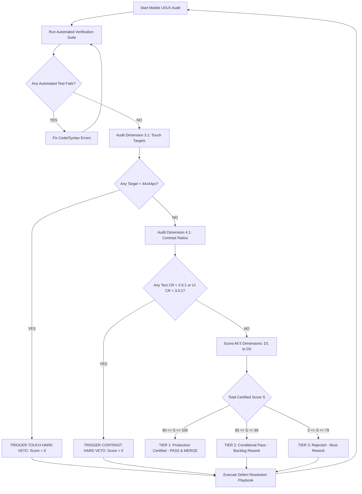

# Mobile UI/UX Flow & Design Intelligence Quality Audit Rubric: Objective 100-Point Verification Engine & Hard Veto Codex

- **Document Version**: 2.0.0
- **Standard**: MealWise Mobile-First Design & UI/UX Pro Max Verification Standard
- **Scope**: Requirement R4 (Automated Quality Audit & Flow Evaluation Rubric)
- **Target Repository**: `d:\New folder\Remotion\Design`
- **Execution Authority**: Lead Mobile Architect, QA Engineers, Design System Auditors

---

## Executive Summary & Anti-Subjectivity Philosophy

Subjective review ("the layout feels clean", "the animation looks nice", "the contrast seems adequate") is the single greatest failure mode of software product design. Subjective assessments lead directly to:
1. Inaccessible contrast that excludes low-vision users.
2. Undersized touch targets that cause frustrating "fat-finger" mis-taps.
3. Unhandled error or empty states that strand users in silent application dead-ends.
4. Broken mobile safe-area geometry where Dynamic Islands, camera notches, or home indicator swipe bars obscure critical buttons.
5. Insecure or broken feature gating where unauthenticated guests encounter runtime crashes instead of graceful authentication prompts.

This audit rubric replaces aesthetic opinion with **deterministic mathematical equations**, **binary pass/fail invariants**, and **strictly quantified tolerances**. Every mobile screen, interactive component, modal drawer, and multi-step wizard evaluated under this standard must produce reproducible, scoreable evidence across five orthogonal 20-point dimensions totaling 100 points.

```
+====================================================================================+
|                    100-POINT MOBILE UI/UX QUALITY AUDIT RUBRIC                     |
+====================================================================================+
|  Dimension 1: Mobile Ergonomics & Safe Area Geometry                 (20 Points)   |
|  - D1.1: Thumb-Zone Spatial Hierarchy Allocation                    [5 pts]        |
|  - D1.2: Environmental Safe Area Insets & Dynamic Hardware Avoidance  [5 pts]        |
|  - D1.3: Viewport Responsiveness across 7 Canonical Device Widths     [5 pts]        |
|  - D1.4: Zero Horizontal Overflow Invariant (W_scroll <= W_viewport)  [5 pts]        |
+------------------------------------------------------------------------------------+
|  Dimension 2: Invariant 5-State Architecture & Error Handling        (20 Points)   |
|  - D2.1: State 1 (Initial/Empty) & State 2 (Loading/Skeleton)        [5 pts]        |
|  - D2.2: State 3 (Active/Populated) & List Virtualization Performance [5 pts]       |
|  - D2.3: State 4 (Error/Retry) & Idempotent Fault Recovery            [5 pts]        |
|  - D2.4: State 5 (Partial/Filtered) & 1-Tap Recovery Continuity       [5 pts]        |
+------------------------------------------------------------------------------------+
|  Dimension 3: Visual Hierarchy & Touch Target Compliance [HARD GATE] (20 Points)   |
|  - D3.1: Minimum Touch Target Bounding Box & Decoupling [HARD VETO]  [5 pts]        |
|  - D3.2: Inter-Target Clearance & Fat-Finger Prevention              [5 pts]        |
|  - D3.3: Normalized Visual Weight (VW) Model & Single Focal Dominance [5 pts]       |
|  - D3.4: Typographic 3-Tier Hierarchy & Non-Ambiguity Invariant      [5 pts]        |
+------------------------------------------------------------------------------------+
|  Dimension 4: WCAG 2.1 AA/AAA Contrast & Dual-Theme      [HARD GATE] (20 Points)   |
|  - D4.1: WCAG 2.1 AA Contrast Compliance [BINARY HARD VETO GATE]     [8 pts]        |
|  - D4.2: WCAG 2.1 AAA Contrast Target & OKLCH Luminance Monotonicity  [4 pts]        |
|  - D4.3: 60-30-10 Palette Distribution & Organic Culinary Harmonies  [4 pts]        |
|  - D4.4: Semantic Non-Color Redundancy & Dual-Theme Parity           [4 pts]        |
+------------------------------------------------------------------------------------+
|  Dimension 5: Navigation Flow Continuity & Guest Account Gating       (20 Points)   |
|  - D5.1: Guest Account Feature Gating & Lock Badge ("Đi Chợ Chung 🔒") [5 pts]      |
|  - D5.2: Multi-Step Wizard Engine & Form Validation Gates            [5 pts]        |
|  - D5.3: Draggable Modal Bottom Sheet & Dismissal Physics            [5 pts]        |
|  - D5.4: Dead-End Avoidance, React Hook Invariant & Diacritics Search [5 pts]       |
+====================================================================================+
| TOTAL SCORE: 100 POINTS (Subject to Absolute Binary Hard Veto Overrides)           |
+====================================================================================+
```

---

### The Absolute Binary Accessibility & Touch Target Hard Veto

> ⚠️ **MANDATORY HARD GATE (Dimensions 3.1 & 4.1)**:
> In accordance with international accessibility mandates (WCAG 2.1 Level AA) and native mobile interaction physiology:
> 
> 1. **Contrast Hard Veto**: If **any** normal reading text ($< 18\text{pt} / 24\text{px}$ regular, $< 14\text{pt} / 18.66\text{px}$ bold) fails the WCAG 2.1 AA contrast threshold ($CR < 4.5:1$), or if **any** large text or essential active UI component fails ($CR < 3.0:1$) in **either Light Mode or Dark Mode**, OR
> 2. **Touch Target Hard Veto**: If **any** interactive touch target (button, icon tap, checkbox, pill chip, stepper trigger) possesses an interactive hit bounding box of less than **$44 \times 44\text{px}$** on iOS ($< 48 \times 48\text{px}$ on Android):
> 
> **THE OVERALL AUDIT SCORE IS IMMEDIATELY OVERRIDDEN TO ZERO (0 / 100) — REJECTED (HARD VETO)**.
> 
> Formally, the Certified Audit Score $S_{\text{certified}}$ is defined by the hard veto operator $\mathcal{V}$:
> 
> $$S_{\text{certified}} = \mathcal{V}(\text{Artifact}) \times \sum_{d=1}^{5} D_d$$
> 
> Where:
> 
> $$\mathcal{V}(\text{Artifact}) = \begin{cases} 
> 0 & \text{if } \exists \text{ text with } CR < 4.5:1 \text{ (or large/UI with } CR < 3.0:1 \text{)} \\
> 0 & \text{if } \exists \text{ interactive target with } \min(\text{width}, \text{height}) < 44\text{px} \\
> 1 & \text{otherwise}
> \end{cases}$$
> 
> No degree of fluid spring animation, elegant typographic scale, or sophisticated color harmony can compensate for an artifact that physically bars users with low vision or motor impairments from operating the interface.

---

## Part 1: Rubric Architecture & Core Principles

### 1.1 Mathematical Scoring Architecture

The rubric evaluates artifacts across five orthogonal dimensions of exactly 20 points each. The dimensions are mutually exclusive:
- **Dimension 1 (Ergonomics)** evaluates physical reach zones, device boundaries, hardware insets, and container widths.
- **Dimension 2 (State Machine)** evaluates temporal lifecycle states, skeleton transitions, and fault recovery.
- **Dimension 3 (Hierarchy & Touch)** evaluates perceptual visual weight, typography structure, and physical tap target bounding boxes.
- **Dimension 4 (Color & Contrast)** evaluates photometric luminance ratios, palette ratios, and dual-theme accessibility.
- **Dimension 5 (Navigation & Gating)** evaluates task completion journeys, guest feature gating, gesture dismissals, and architecture safety.

---

### 1.2 Standard Certification Tiers & Decision Rules

Every evaluated UI flow or component receives a numerical certified score $S \in [0, 100]$ and is classified into one of four mutually exclusive certification tiers:

| Tier Range | Certification Tier | Operational Decision | Deployment & Merge Policy |
| :---: | :--- | :--- | :--- |
| **90 – 100** | **Tier 1: Production Certified** | **PASS & MERGE** | Immediate approval for production release. The component adheres to all mobile ergonomics, 5-state invariants, accessibility thresholds, and guest security gates. |
| **80 – 89** | **Tier 2: Conditional Pass** | **PROVISIONAL ACCEPTANCE** | Admitted for staging and internal dogfooding. Non-blocking minor defects (e.g., secondary text contrast between $4.5:1$ and $7.0:1$, or minor padding asymmetries) must be logged in the sprint backlog and remediated before general availability. |
| **0 – 79** | **Tier 3: Rejected** | **REJECTED (REWORK)** | Blocked from merging. Fails foundational mobile interaction standards, missing error states, or broken responsiveness. Must undergo structured remediation per the Defect Playbook. |
| **TRIGGERED** | **Hard Veto Triggered** | **IMMEDIATE HARD VETO (0 PTS)** | **Total score automatically overridden to 0**. Asset commits a critical accessibility violation ($CR < 4.5:1$) or undersized touch target ($< 44\text{px}$). Blocked unconditionally. |

---

### 1.3 Zero-Subjectivity Rules & Deterministic Verification Mechanics

To ensure 100% reproducibility between different auditors, static analysis linters, and headless CI bots:
1. **Mathematical Falsifiability**: Every criterion must be evaluated via reproducible formulas (e.g., relative luminance via ITU-R BT.709, touch target dimensions via DOM `getBoundingClientRect()`, thumb-zone percentage via viewport height division).
2. **Binary Granularity**: Within each sub-rule, points are awarded based on exact threshold compliance. If a rule specifies touch targets $\ge 44\text{px}$, a button measuring $42\text{px}$ receives 0 points and triggers the Hard Veto.
3. **Auditor Evidence Trail**: Evaluations must record concrete values: measured contrast ratio, pixel dimensions, token keys, viewport widths tested, and file paths.

---

## Part 2: The 5 Core Evaluation Dimensions (20 Points Each)

---

### Dimension 1: Mobile Ergonomics & Safe Area Geometry (20 Points)

#### D1.1: Thumb-Zone Spatial Hierarchy Allocation (5 Points)
- **Objective Standard**: Human thumb traversal across a smartphone display follows an asymmetric polar arc anchored at the carpometacarpal (CMC) joint. When holding a phone single-handedly, the display naturally partitions into three functional zones:
  - **Natural Zone (Bottom 40% of Viewport)**: Effortless radial sweep; maximum motor accuracy and zero grip adjustments.
  - **Reach Zone (Middle 35% of Viewport)**: Accessible with moderate thumb stretch; suitable for content cards and filters.
  - **Hard Zone (Top 25% of Viewport)**: Requires dropping the palm or using a second hand; high drop risk.
- **Evaluation Criteria**:
  1. *Primary Conversion CTAs*: All primary actions (e.g., "Gán vào thực đơn", "Thêm vào giỏ", "Nấu ngay", bottom drawer confirmations) MUST be positioned strictly within the Natural Zone (bottom 40%).
  2. *Sticky Bottom Anchoring*: Persistent action bars and navigation tabs must reside within the Natural Zone.
  3. *Hard Zone Prohibition*: Primary conversion buttons, critical confirmation actions, or destructive triggers MUST NEVER be placed in the Hard Zone. The Hard Zone is strictly reserved for passive titles, back navigation, and status telemetry.
- **Scoring Rubric**:
  - **5 pts**: 100% of primary CTAs and navigation controls reside within the Natural Zone; zero action triggers in the Hard Zone.
  - **3 pts**: Primary CTAs are reachable, but a secondary high-frequency action (e.g., search trigger or primary filter toggle) resides in the Hard Zone without bottom sticky mirroring.
  - **0 pts**: Critical primary conversion CTA placed in the Hard Zone (top 25%), forcing awkward two-handed operation.

---

#### D1.2: Environmental Safe Area Insets & Dynamic Hardware Avoidance (5 Points)
- **Objective Standard**: Modern mobile hardware features physical intrusions: camera notches, Dynamic Islands, pill cutouts, and bottom gesture indicator swipe bars. Interfaces must dynamically accommodate these via CSS environment variables: `env(safe-area-inset-top)` and `env(safe-area-inset-bottom)`.
  - Canonical values:
    * iOS Dynamic Island / Notch: Top inset $44\text{px}$–$59\text{px}$.
    * iOS Home Indicator: Bottom inset $34\text{px}$.
    * Android Gesture Navigation: Bottom inset $16\text{px}$–$24\text{px}$, Top punch-hole $24\text{px}$–$36\text{px}$.
- **Evaluation Criteria**:
  1. *Top Header Inset*: Sticky top headers and navigation bars must incorporate:
     `padding-top: max(16px, env(safe-area-inset-top, 0px));` or Tailwind `pt-[env(safe-area-inset-top,0px)]`.
  2. *Bottom Action Bar Inset*: Fixed bottom bars and bottom navigation tabs must incorporate:
     `padding-bottom: calc(0.75rem + env(safe-area-inset-bottom, 0px));` or Tailwind `pb-[calc(0.75rem+env(safe-area-inset-bottom,0px))]`.
  3. *Modal Bottom Sheet Inset*: Draggable drawers must incorporate bottom clearance:
     `padding-bottom: calc(1rem + env(safe-area-inset-bottom, 0px));`.
- **Scoring Rubric**:
  - **5 pts**: Full mathematical safe-area inset incorporation on all top bars, bottom action bars, modals, and sheets; zero collision with hardware bars.
  - **3 pts**: Safe area insets present on bottom bar, but top bar relies on hardcoded pixel padding (e.g., `pt-4`), risking clipping on Dynamic Island devices.
  - **0 pts**: Completely absent safe area insets; primary action buttons collide directly with the iOS home swipe bar.

---

#### D1.3: Viewport Responsiveness across 7 Canonical Device Widths & Desktop Clamping Invariant (5 Points)
- **Objective Standard**: Mobile layouts must render flawlessly across the seven canonical device viewport widths without horizontal clipping or broken layouts:
  1. `320px`: iPhone SE 1st Gen, Galaxy Fold (outer screen)
  2. `360px`: Samsung Galaxy A & S series base width
  3. `375px`: iPhone SE 2/3, iPhone 12/13 mini
  4. `390px`: iPhone 12 / 13 / 14 / 15 / 16 standard reference
  5. `414px / 428px`: iPhone Plus, Pro Max, Galaxy Ultra
  6. `768px`: iPad portrait, Android tablets (2-column grid)
  7. `1280px+`: Desktop / Widescreen displays
- **The Desktop Clamping Invariant**:
  Because MealWise is strictly optimized as a mobile smartphone experience, viewing the app on widescreen displays must NEVER stretch the mobile view across 1280px. The interface must be enclosed inside a centered container clamped to `max-w-lg` ($512\text{px}$ max width) with an elevated drop shadow.
- **Scoring Rubric**:
  - **5 pts**: All 7 viewports validated; 1-column mobile core, 2-column tablet layout, and desktop shell strictly clamped to `max-w-lg` ($512\text{px}$).
  - **3 pts**: Mobile widths $360\text{px}$–$428\text{px}$ functional, but minor padding clipping at $320\text{px}$, or tablet layout remains 1-column.
  - **0 pts**: Unclamped desktop layout that stretches mobile dish cards across $1280\text{px}$, or broken layout at $320\text{px}$.

---

#### D1.4: Zero Horizontal Overflow Invariant ($W_{\text{scroll}} \le W_{\text{viewport}}$) (5 Points)
- **Objective Standard**: Horizontal scrolling on a mobile smartphone is a critical UX failure that disrupts edge-swipe gestures and hides interface elements.
  $$\forall W_{\text{viewport}} \in [320\text{px}, \infty), \quad W_{\text{scroll}} \le W_{\text{viewport}}$$
- **Evaluation Criteria**:
  1. *Flexbox Collapse Protection*: In CSS flex containers, children have default `min-width: auto`. Any flex container holding text strings (such as long Vietnamese dish titles) must enforce:
     - `min-w-0` on the flex child.
     - `truncate` or `break-words` on the text string.
     - `overflow-hidden` on the outer card container.
  2. *Zero Outer Scrollbar*: No horizontal scrollbar appears at any viewport width.
- **Scoring Rubric**:
  - **5 pts**: Flawless zero-overflow invariant satisfied across all screens; mandatory flexbox trifecta (`min-w-0`, `truncate`, `overflow-hidden`) strictly applied.
  - **3 pts**: Zero overflow on standard $390\text{px}$ viewports, but an unconstrained string causes 4px–10px overflow at $320\text{px}$.
  - **0 pts**: Severe horizontal overflow ($W_{\text{scroll}} > W_{\text{viewport}}$), inducing horizontal page wobble.

---

### Dimension 2: Invariant 5-State Architecture & Error Handling (20 Points)

Every view, screen, bottom drawer, and major component container MUST explicitly implement and handle all five lifecycle states:

```
                  +--------------------------------+
                  |  5 INVARIANT VIEW STATES       |
                  +--------------------------------+
                  |  State 1: Initial / Empty      |
                  |  State 2: Loading / Skeleton   |
                  |  State 3: Active / Populated   |
                  |  State 4: Error / Retry        |
                  |  State 5: Partial / Filtered   |
                  +--------------------------------+
```

---

#### D2.1: State 1 (Initial / Empty) & State 2 (Loading / Skeleton) Invariants (5 Points)
- **Objective Standard**:
  1. **State 1: Initial / Empty (`STATE_EMPTY`)**:
     - *Trigger*: Dataset collection is empty ($N = 0$).
     - *Mandatory Anatomy*:
       * Visual asset/illustration: Thematic culinary metaphor (e.g., empty refrigerator, clean basket). Must strictly adhere to Food Photography Purity—zero human faces.
       * Empathetic Headline: Informative, non-judgmental title (e.g., "Tủ Lạnh Chưa Có Món Nào").
       * Contextual Subtext: Explains value of populating data.
       * Primary Action CTA: Minimum touch target $\ge 44 \times 44\text{px}$ in Natural Zone.
     - *Prohibition*: Never display a blank white canvas or unstyled raw text.
  2. **State 2: Loading / Skeleton (`STATE_LOADING`)**:
     - *Trigger*: Asynchronous operation in progress ($t > 100\text{ms}$).
     - *CLS = 0 Invariant*: Skeleton placeholders must match the exact dimensions, aspect ratios ($16:9$, $4:3$), and border radii of the populated cards to guarantee Cumulative Layout Shift $\text{CLS} = 0$.
     - *Prohibition*: Never display a solitary spinning wheel centered on a blank canvas.
     - *Reduced Motion*: Must support `@media (prefers-reduced-motion: reduce)` by falling back to subtle static opacity pulse.
- **Scoring Rubric**:
  - **5 pts**: Both Empty and Loading states fully specified; CLS = 0 guaranteed; culinary image purity respected; reduced motion supported.
  - **3 pts**: Empty state has CTA and text but generic icon; Skeleton placeholders present but dimensions differ slightly from active cards ($\text{CLS} > 0$).
  - **0 pts**: Blank screen rendered during empty state, or standalone spinning loader used on blank canvas.

---

#### D2.2: State 3 (Active / Populated) & List Virtualization Performance (5 Points)
- **Objective Standard**:
  1. *Active Layout Visual Hierarchy*: When data resolves ($N \ge 1$), layout presents scannable hierarchy with dominant hero cards ($VW \ge 80$) and secondary cards ($VW \in [55, 80]$).
  2. *List Virtualization Performance*: If a catalog or feed can exceed 50 items (e.g., 500+ Vietnamese recipes), the list container must incorporate window virtualization to ensure 60fps scrolling and memory consumption under $35\text{MB}$.
  3. *Consistent Card Spacing*: Spacing between cards conforms to Base-4 grid tokens (`16px`–`20px`).
- **Scoring Rubric**:
  - **5 pts**: Active state exhibits clean visual hierarchy, touch-compliant card controls ($\ge 44\text{px}$), and virtualization for large collections.
  - **3 pts**: Active state well-styled, but lacking list virtualization for datasets $> 50$ items.
  - **0 pts**: Unpaginated, un-virtualized DOM dumps causing scroll lag and jank.

---

#### D2.3: State 4 (Error / Retry) & Idempotent Fault Recovery (5 Points)
- **Objective Standard**:
  1. *Non-Cryptic Diagnostics*: When an error occurs (network failure, HTTP 5xx, parsing failure), display clear human-readable Vietnamese copy (e.g., "Không thể tải danh sách thực đơn. Vui lòng kiểm tra kết nối WiFi/4G.").
  2. *Actionable Recovery Affordance*: Prominent "Thử lại" (Retry) button ($\ge 44 \times 44\text{px}$) wired directly to an idempotent re-fetch callback.
  3. *Semantic Visual Redundancy*: Pair semantic Rose alert color with an explicit `<AlertCircle />` icon (WCAG 1.4.1 non-color reliance).
  4. *Secondary Fallback*: When available, provide an escape hatch (e.g., "Sử dụng dữ liệu ngoại tuyến" or "Quay lại trang chủ").
  5. *Prohibition*: Never display raw stack traces, unhandled promise rejections, or dead-end alert boxes with only an "OK" button.
- **Scoring Rubric**:
  - **5 pts**: Friendly human explanation; prominent "Thử lại" CTA ($\ge 44\text{px}$); semantic icon paired with color; zero unhandled crashes.
  - **3 pts**: Error banner explains problem and has "Thử lại" button, but lacks semantic icon or secondary fallback.
  - **0 pts**: Raw exception displayed, unhandled promise crash, or dead-end message with no retry mechanism.

---

#### D2.4: State 5 (Partial / Filtered) & 1-Tap Recovery Continuity (5 Points)
- **Objective Standard**:
  1. *Active Criteria Visibility*: When search queries or filter pills are applied, display active filter chips with individual "×" dismiss triggers and an item match counter (e.g., "Hiển thị 14 / 120 món").
  2. *Zero-Result Recovery Invariant*: When active filters yield zero matching items ($N_{\text{filtered}} = 0$):
     - The view MUST render a dedicated filtered-empty state.
     - The view MUST provide a mandatory **1-Tap "Xóa bộ lọc" (Clear filters)** or "Xem tất cả công thức" reset button.
     - Tapping the reset CTA immediately clears filters and restores `STATE_ACTIVE`.
  3. *Prohibition*: The user must NEVER become trapped in a 0-result view without an immediate, 1-tap recovery trigger.
- **Scoring Rubric**:
  - **5 pts**: Active filter chips with "×" dismiss; accurate match counter; dedicated 0-result card with 1-tap "Xóa bộ lọc" reset button.
  - **3 pts**: 0-result state displays a reset button, but active filter chips do not show individual dismiss triggers.
  - **0 pts**: Zero-result filtered state displays blank screen or lacks a "Xóa bộ lọc" reset CTA, trapping the user.

---

### Dimension 3: Visual Hierarchy & Touch Target Compliance (20 Points)

---

#### D3.1: Minimum Touch Target Bounding Box & Decoupling Invariant [HARD VETO GATE] (5 Points)
- **Objective Standard**: Adult human thumb pads measure approximately $10\text{mm} \times 10\text{mm}$ to $12\text{mm} \times 12\text{mm}$, translating to $44\text{px}$ to $48\text{px}$ on high-DPI smartphone displays.
  - Apple iOS Human Interface Guidelines: Minimum **$44 \times 44\text{px}$**.
  - Google Android Material Design: Minimum **$48 \times 48\text{px}$**.
- **The Visual vs. Hit Target Decoupling Rule**:
  Small visual icons ($18\text{px}$–$24\text{px}$, such as bookmark stars, modal close chevrons, or search clear icons) MUST have their interactive hit bounding box expanded to at least $44 \times 44\text{px}$ via padding or wrapping container.
- **THE BINARY TOUCH TARGET HARD VETO**:
  $$\text{If } \exists \text{ interactive element with } \min(\text{width}, \text{height}) < 44\text{px} \implies \text{TOTAL AUDIT SCORE} = \mathbf{0} \text{ (REJECTED)}$$
- **Scoring Rubric**:
  - **5 pts**: 100% of interactive controls (buttons, chips, toggles, icon hits) measure $\ge 44 \times 44\text{px}$ ($\ge 48\text{px}$ on Android); visual-hit decoupling verified.
  - **0 pts [HARD VETO]**: Any interactive control measures $< 44\text{px}$. Overall score overridden to **0 / 100 — REJECTED**.

---

#### D3.2: Inter-Target Clearance & Fat-Finger Prevention (5 Points)
- **Objective Standard**: Adjacent interactive controls (e.g., quantity stepper `-` and `+` buttons, filter pills, or table row actions) must maintain a minimum physical edge-to-edge separation:
  $$d_{\text{gap}} \ge 8\text{px}$$
- **Scoring Rubric**:
  - **5 pts**: All adjacent interactive elements maintain $d_{\text{gap}} \ge 8\text{px}$; zero accidental mis-taps.
  - **3 pts**: Most controls spaced $\ge 8\text{px}$, but one cluster (e.g., inline compact tag pills) uses $4\text{px}$ gap.
  - **0 pts**: Interactive controls touching or overlapping ($d_{\text{gap}} = 0\text{px}$), causing frequent mis-taps.

---

#### D3.3: Normalized Visual Weight ($VW$) Model & Single Focal Dominance (5 Points)
- **Objective Standard**: Visual dominance is calculated via the 5-factor Normalized Visual Weight Model ($VW \in [0, 100]$):
  $$VW = 100 \times \left( 0.25 f_A + 0.30 f_C + 0.15 f_S + 0.15 f_P + 0.15 f_I \right)$$
  Where:
  - $f_A = \min\left(1.0, \sqrt{\text{Area}_{\text{element}} / (\text{Area}_{\text{viewport}} \times 0.25)}\right)$ (Area factor)
  - $f_C = |L_{\text{element}} - L_{\text{background}}| / \max(L_{\text{element}}, L_{\text{background}}, 0.05)$ (Luminance contrast factor)
  - $f_S = \min(1.0, C_{\text{OKLCH}} / 0.22)$ (Perceptual chroma factor)
  - $f_P \in [0.40, 0.95]$ (Positional prominence: POA=0.95, TA=0.90, Center=0.85, Weak Fallow=0.40)
  - $f_I = \min(1.0, \text{Margin}_{\text{clear}} / \min(W_{\text{element}}, H_{\text{element}}))$ (Isolation factor)
- **The Focal Dominance Rule**:
  1. Every screen viewport must contain **exactly one Hero Focal Point** ($VW \ge 80$).
  2. The primary hero must maintain at least $1.5\times$ the visual weight of secondary nodes:
     $$\frac{VW_{\text{primary}}}{VW_{\text{secondary}}} \ge 1.5$$
- **Scoring Rubric**:
  - **5 pts**: Exactly one dominant hero with $VW \ge 80$; $VW_{\text{primary}} / VW_{\text{secondary}} \ge 1.5$; clear visual role tiering.
  - **3 pts**: Single hero exists ($VW \ge 75$), but ratio to secondary elements falls between $1.2$ and $1.49$.
  - **0 pts**: Multiple competing hero elements ($VW \ge 80$) causing visual fatigue and decision paralysis.

---

#### D3.4: Typographic 3-Tier Hierarchy & Non-Ambiguity Invariant (5 Points)
- **Objective Standard**: Typography must follow a 3-tier structure derived from canonical Major Third (1.250) tokens:
  - **Tier 1 (Hero / H1 / Page Title)**: $24\text{px} - 32\text{px}$ (`typography.scale.2xl` to `4xl`), Bold (700).
  - **Tier 2 (Section Title / Card Header)**: $18\text{px} - 20\text{px}$ (`scale.lg` to `xl`), Semibold (600).
  - **Tier 3 (Body Copy / Metadata / Captions)**: $12\text{px} - 16\text{px}$ (`scale.xs` to `base`), Regular (400) or Medium (500).
- **The Non-Ambiguity Invariant**:
  Adjacent typographic tiers must satisfy:
  $$\Delta \text{Scale Steps} \ge 2 \quad \mathbf{OR} \quad (\Delta \text{Font Weight} \ge 200 \; \mathbf{AND} \; \Delta \text{Contrast Ratio} \ge 3.0:1)$$
- **Scoring Rubric**:
  - **5 pts**: 3 tiers cleanly defined; Non-Ambiguity Invariant strictly satisfied; monotonic weight descent.
  - **3 pts**: 3 tiers present, but transition between Tier 2 and Tier 3 has only 1 scale step without weight/contrast boost.
  - **0 pts**: Inverted hierarchy (e.g., metadata rendered bolder or larger than section heading).

---

### Dimension 4: WCAG 2.1 AA/AAA Contrast & Dual-Theme Invariance (20 Points) [ACCESSIBILITY HARD VETO GATE]

---

#### D4.1: WCAG 2.1 AA Contrast Compliance [BINARY HARD VETO GATE] (8 Points)
- **Mathematical Specification**: Relative luminance $L$ is calculated via piecewise linear sRGB gamma expansion and ITU-R Recommendation BT.709 spectral weighting:
  $$C_{\text{linear}} = \begin{cases} \frac{C_{\text{sRGB}}}{12.92} & \text{if } C_{\text{sRGB}} \le 0.04045 \\ \left( \frac{C_{\text{sRGB}} + 0.055}{1.055} \right)^{2.4} & \text{if } C_{\text{sRGB}} > 0.04045 \end{cases}$$
  $$L = 0.2126 \cdot R_{\text{linear}} + 0.7152 \cdot G_{\text{linear}} + 0.0722 \cdot B_{\text{linear}}$$
  $$\mathbf{CR = \frac{L_1 + 0.05}{L_2 + 0.05}} \quad (L_1 \ge L_2)$$
- **Mandatory Thresholds**:
  - **Normal Text ($< 18\text{pt} / 24\text{px}$ regular, $< 14\text{pt} / 18.66\text{px}$ bold)**: $\mathbf{CR \ge 4.5:1}$.
  - **Large Text ($\ge 18\text{pt} / 24\text{px}$ regular, $\ge 14\text{pt} / 18.66\text{px}$ bold)**: $\mathbf{CR \ge 3.0:1}$.
  - **Active UI Components & Input Borders**: $\mathbf{CR \ge 3.0:1}$.
  - **Dual-Theme Invariance**: Must hold in **both Light Mode and Dark Mode**.
- **THE BINARY CONTRAST HARD VETO**:
  $$\text{If } \exists \text{ text or control with } CR < \text{Threshold} \implies \text{D4.1} = 0 \text{ pts } \mathbf{AND} \text{ TOTAL AUDIT SCORE} = \mathbf{0} \text{ (REJECTED)}$$
- **Scoring Rubric**:
  - **8 pts**: 100% of text and active controls pass WCAG 2.1 AA in both light and dark modes.
  - **0 pts [HARD VETO]**: Single failure detected. Entire audit overridden to **0 / 100 — REJECTED**.

---

#### D4.2: WCAG 2.1 AAA Contrast Target & OKLCH Luminance Monotonicity (4 Points)
- **Objective Standard**:
  1. *WCAG AAA Target*: Primary body copy, article text, and critical recipe ingredients achieve $\mathbf{CR \ge 7.0:1}$ against background canvas.
  2. *Monotonic Luminance Steps*: Palette color steps (50 to 950) in OKLCH perceptual space must demonstrate strictly monotonic relative luminance decrease:
     $$\forall i \in [50, 900], \quad L(\text{step}_i) > L(\text{step}_{i+1})$$
     Chroma envelope tapers toward zero at luminance poles to eliminate chalky highlights and clipped out-of-gamut darks.
- **Scoring Rubric**:
  - **4 pts**: Primary text achieves AAA ($\ge 7.0:1$); palette steps demonstrate strict luminance monotonicity.
  - **2 pts**: Passes AA across all text, but primary text falls short of AAA ($4.5:1 \le CR < 7.0:1$).
  - **0 pts**: Inverted color ramps where darker numerical steps have higher luminance than lighter steps.

---

#### D4.3: 60-30-10 Palette Distribution & Organic Culinary Harmonies (4 Points)
- **Objective Standard**:
  1. *Surface Area Allocation*:
     - **60% Dominant Base**: Canvas background, card surfaces, structural whitespace (`#FAF8F5`, `#FFFFFF` in Light; `#121110`, `#1C1917` in Dark).
     - **30% Structural Secondary**: Neutral text, subtle card borders, dividers, secondary chips (`slate-600`, `stone-600`, `slate-200`).
     - **10% High-Energy Accent**: Primary conversion buttons, active status badges, key highlights ($\mathbf{\text{Area}_{\text{accent}} \le 0.10 \times \text{Area}_{\text{total}}}$).
  2. *Nuanced Natural Harmony*:
     - Culinary and lifestyle interfaces avoid raw default primaries (pure `#ff0000` or raw neon amber). Palettes use organic stone, warm amber, and deep botanical greens.
- **Scoring Rubric**:
  - **4 pts**: Strict adherence to 60-30-10 distribution; accent area $\le 10\%$; sophisticated organic palette.
  - **2 pts**: Accent area slightly over-utilized ($11\% - 15\%$), creating mild visual noise.
  - **0 pts**: Unregulated saturated accent colors spanning $> 20\%$ of surface area, or discordant raw neon clashes.

---

#### D4.4: Semantic Non-Color Redundancy & Dual-Theme Parity (4 Points)
- **Objective Standard**:
  1. *Color-Blind Non-Color Reliance (WCAG 1.4.1)*: Color must never be the sole carrier of status information. All status alerts (Success, Warning, Error, Info) must pair semantic colors with an explicit icon glyph or text label.
  2. *4-Role Semantic Matrix*: Every status state must implement the 4-token set: `base` (icon), `background` (subtle tint), `text` (high-contrast AAA copy), and `border` (stroke).
  3. *Dual-Theme Parity*: Visual weight and contrast must maintain equal legibility in both Light Mode (`#FAF8F5`) and Dark Mode (`#121110`).
- **Scoring Rubric**:
  - **4 pts**: 100% of semantic states pair color with icons/text; 4-role matrix utilized; full light and dark mode parity.
  - **2 pts**: Semantic states use proper tokens, but 1 state relies solely on border/text color without an auxiliary icon.
  - **0 pts**: Status communicated exclusively by color change with zero textual or iconographic indicators.

---

### Dimension 5: Navigation Flow Continuity & Guest Account Gating (20 Points)

---

#### D5.1: Guest Account Feature Gating & Lock Affordance (5 Points)
- **Objective Standard**:
  1. *Collaborative Grocery Sharing Gating (`Đi Chợ Chung`)*:
     - Real-time shared shopping rooms require registered accounts.
     - When user is an unregistered guest (`!isRegistered`):
       * The button label MUST display a lock badge: **`Đi Chợ Chung 🔒`**.
       * Tapping the button MUST NOT crash, throw runtime exceptions, or silently fail.
       * Tapping MUST immediately present an in-app `AuthModal` in registration/login mode explaining the real-time sync benefits.
  2. *Account-Scoped Onboarding Isolation*:
     - Onboarding completion status must be isolated per registered email:
       $$\text{StorageKey} = \text{mealwise\_onboarding\_completed\_} + \text{email.toLowerCase()}$$
     - Global guest storage flags must NEVER suppress onboarding for a new registration.
  3. *Existing Plan Retention Guard*:
     - When an unregistered guest who created custom meal plans registers, the application must display an explicit confirmation toggle to **retain existing weekly meals** rather than silently overwriting them.
- **Scoring Rubric**:
  - **5 pts**: Button displays `Đi Chợ Chung 🔒` for guests; opens AuthModal gracefully; account-scoped onboarding isolated; plan retention prompt active.
  - **3 pts**: Lock badge displayed and AuthModal opens, but guest registration silently overwrites pre-existing custom meal plans without asking.
  - **0 pts**: Unregistered guest tapping `Đi Chợ Chung` triggers an unhandled crash or dead-end, or lock badge is missing.

---

#### D5.2: Multi-Step Wizard Engine & Form Validation Gates (5 Points)
- **Objective Standard**:
  Multi-step sequences (e.g., Onboarding 4-Step: Region $\to$ Family $\to$ Budget $\to$ Dietary Goals):
  1. *Validation Gate*: The `NEXT` action button is strictly disabled until the active step's mandatory inputs satisfy schema validation.
  2. *Sticky Progress Indicator*: Displays real-time progress:
     $$P_{\text{progress}} = \frac{k - 1}{N - 1} \times 100\%$$
  3. *Dirty-State Exit Protection*: If the user attempts to dismiss the modal after modifying data, an in-app confirmation modal prevents accidental data loss ("Bạn có thay đổi chưa lưu. Bạn có chắc muốn thoát?").
- **Scoring Rubric**:
  - **5 pts**: Strict validation gates on `NEXT`; sticky progress indicator; dirty-state exit protection modal in place.
  - **3 pts**: Steps validate correctly and progress bar functions, but closing the modal discards modified data without warning.
  - **0 pts**: User can click `NEXT` through invalid empty steps, producing corrupt application state.

---

#### D5.3: Draggable Modal Bottom Sheet & Dismissal Physics (5 Points)
- **Objective Standard**:
  Native gesture bottom sheets (used for recipe inspections and dish assignments):
  1. *Drag Handle Anatomy*: Centered pill $36 \times 4\text{px}$, `rounded-full`, with vertical margin.
  2. *Dismissal Threshold Rule*:
     - Downward touch drag $\Delta y > 75\text{px}$: Triggers dismiss callback; sheet animates off-screen over $200\text{ms}$.
     - Downward drag $\Delta y \le 75\text{px}$: Snaps back to rest position ($\Delta y = 0$) using CSS spring easing `cubic-bezier(0.16, 1, 0.3, 1)`.
     - Upward drag is damped by factor $0.2\times$ (rubber-band resistance).
  3. *Backdrop Tap Shield*: Tapping semi-transparent backdrop dismisses sheet; sheet content container calls `e.stopPropagation()` to prevent internal taps from triggering dismissal.
  4. *Safe Area Padding*: Bottom action button bar incorporates `pb-[calc(1rem+env(safe-area-inset-bottom,0px))]`.
- **Scoring Rubric**:
  - **5 pts**: Drag handle pill present; $75\text{px}$ dismissal threshold strictly enforced; snap spring applied; safe area padding included; backdrop tap shield verified.
  - **3 pts**: Dismisses on drag and backdrop tap, but lacks rubber-banding resistance on upward drag or dismisses too easily ($< 30\text{px}$).
  - **0 pts**: Bottom sheet cannot be dismissed via downward gesture, or taps inside the sheet body accidentally close it.

---

#### D5.4: Dead-End Avoidance, React Hook Invariant & Diacritics Search Continuity (5 Points)
- **Objective Standard**:
  1. *Dead-End Avoidance*: Every screen, sub-view, modal, and drawer must provide a visible, touch-compliant escape hatch (back chevron, close "×", or "Hủy" button).
  2. *React Rules of Hooks Compliance*: All React hooks (`useState`, `useMemo`, `useCallback`, `useEffect`, `useRef`) must be placed unconditionally at the very top of the component body, strictly BEFORE any conditional checks or early returns (e.g., `if (!recipe) return null;`). Never place hooks after an early return.
  3. *Diacritics-Insensitive Search Normalization*: Search inputs must normalize Vietnamese tone marks before computing substring matches:
     $$\text{Normalize}(S) = S.\text{normalize}(\text{'NFD'}).\text{replace}(/[\backslash u0300-\backslash u036f]/g, \text{''}).\text{replace}(/đ/g, \text{'d'}).\text{replace}(/Đ/g, \text{'D'}).\text{toLowerCase()}$$
     Ensures `"pho ga"`, `"phở gà"`, and `"PHỞ GÀ"` match identically.
  4. *Food Photography Purity*: All dish and culinary images must depict appetizing food/ingredients. Never display human faces or unrelated non-food graphics.
- **Scoring Rubric**:
  - **5 pts**: Zero navigation dead-ends; React hooks strictly placed at top; diacritics search normalization verified; food photography purity 100% compliant.
  - **3 pts**: Zero dead-ends and hooks compliant, but search requires exact Vietnamese diacritical marks.
  - **0 pts**: Dead-end screen with no back button, React hooks placed conditionally after early returns, or human face imagery used in meal cards.

---

## Part 3: Ready-to-Use Scoreable Audit Checklist & Evaluation Template

Copy this evaluation template directly into the review dossier for any audited mobile view, flow, or component.

```markdown
# MealWise Mobile UI/UX Quality Assurance Audit Scorecard

- **Artifact Name / Component**: [Insert Component / Flow Name]
- **Target File Path**: `[Insert Absolute File Path]`
- **Evaluation Type**: [ ] Native Mobile Screen  [ ] Modal Bottom Sheet  [ ] Multi-Step Wizard  [ ] UI Primitive
- **Auditor Name / Agent ID**: [Insert Auditor ID]
- **Evaluation Date**: [YYYY-MM-DD]
- **Target Platform**: [ ] Mobile iOS (375–428px)  [ ] Mobile Android (360–414px)  [ ] Desktop Shell (max-w-lg)

---

### Scoring Dimension Breakdown

| Dimension | Max Points | Points Earned | Status | Measured Values & Auditor Notes |
| :--- | :---: | :---: | :---: | :--- |
| **Dimension 1: Mobile Ergonomics & Safe Area Geometry** | | | | |
| - D1.1: Thumb-Zone Hierarchy (Bottom 40% CTAs) | 5 pts | [   ] | [PASS / FAIL] | Primary CTA Zone: [   ], Hard Zone CTAs: [ 0 ] |
| - D1.2: Safe Area Insets (env(top) & env(bottom)) | 5 pts | [   ] | [PASS / FAIL] | Top calc: [   ], Bottom calc: [   ] |
| - D1.3: 7 Viewports & Desktop Clamping (max-w-lg) | 5 pts | [   ] | [PASS / FAIL] | 320px check: [PASS], Desktop max-w-lg: [PASS] |
| - D1.4: Zero Horizontal Overflow (W_scroll <= W_v) | 5 pts | [   ] | [PASS / FAIL] | min-w-0: [Y/N], truncate: [Y/N], Overflow: [ 0px ] |
| **D1 Subtotal** | **20 pts** | **[   ]** | | |
| | | | | |
| **Dimension 2: Invariant 5-State Architecture** | | | | |
| - D2.1: State 1 (Empty) & State 2 (Skeleton CLS=0) | 5 pts | [   ] | [PASS / FAIL] | Empty CTA: [   ], Skeleton matches card: [Y/N] |
| - D2.2: State 3 (Active) & List Virtualization | 5 pts | [   ] | [PASS / FAIL] | Hero VW: [   ], Virtualized (>50 items): [Y/N] |
| - D2.3: State 4 (Error) & Actionable "Thử lại" | 5 pts | [   ] | [PASS / FAIL] | Error text: [Human], Retry CTA hit: [   ]px |
| - D2.4: State 5 (Partial) & 1-Tap "Xóa bộ lọc" | 5 pts | [   ] | [PASS / FAIL] | Active chips: [Y/N], 1-tap reset CTA: [Y/N] |
| **D2 Subtotal** | **20 pts** | **[   ]** | | |
| | | | | |
| **Dimension 3: Visual Hierarchy & Touch Target Compliance** | | | | |
| - **D3.1: Min Touch Target (>= 44x44px) [HARD GATE]** | **5 pts** | **[   ]** | **[PASS / VETO]** | **Min Measured Hit: [   ]x[   ]px (Req >= 44px)** |
| - D3.2: Inter-Target Clearance (d_gap >= 8px) | 5 pts | [   ] | [PASS / FAIL] | Minimum measured gap: [   ]px |
| - D3.3: Visual Weight (VW) & Single Dominant Hero | 5 pts | [   ] | [PASS / FAIL] | Hero VW: [   ], Secondary VW: [   ], Ratio: [   ] |
| - D3.4: Typographic 3-Tier Hierarchy & Non-Ambiguity | 5 pts | [   ] | [PASS / FAIL] | Tier 1: [   ], Tier 2: [   ], Tier 3: [   ] |
| **D3 Subtotal** | **20 pts** | **[   ]** | | |
| | | | | |
| **Dimension 4: WCAG Contrast & Dual Themes** | | | | |
| - **D4.1: WCAG 2.1 AA Contrast (>= 4.5:1) [HARD GATE]** | **8 pts** | **[   ]** | **[PASS / VETO]** | **Min Light CR: [   ]:1, Min Dark CR: [   ]:1** |
| - D4.2: WCAG AAA Target & Monotonic OKLCH Ramps | 4 pts | [   ] | [PASS / FAIL] | Body AAA: [   ]:1, Monotonic steps: [Y/N] |
| - D4.3: 60-30-10 Palette & Organic Culinary Neutrals | 4 pts | [   ] | [PASS / FAIL] | Base: [%], Struct: [%], Accent: [%] (<=10%) |
| - D4.4: Semantic Non-Color & Dual-Theme Parity | 4 pts | [   ] | [PASS / FAIL] | Icon paired: [Y/N], Dark Mode parity: [Y/N] |
| **D4 Subtotal** | **20 pts** | **[   ]** | | |
| | | | | |
| **Dimension 5: Navigation Flow & Guest Gating** | | | | |
| - D5.1: Guest Gating ("Đi Chợ Chung 🔒" & Retention) | 5 pts | [   ] | [PASS / FAIL] | Lock badge: [Y/N], AuthModal: [Y/N], Retain: [Y/N] |
| - D5.2: Wizard Validation Gates & Sticky Progress | 5 pts | [   ] | [PASS / FAIL] | Next disabled on invalid: [Y/N], Dirty modal: [Y/N]|
| - D5.3: Bottom Sheet Gestures (75px threshold) | 5 pts | [   ] | [PASS / FAIL] | Dismiss threshold: 75px, Spring snap: [Y/N] |
| - D5.4: Dead-Ends, Hooks at Top & Diacritics Search | 5 pts | [   ] | [PASS / FAIL] | Hooks before returns: [Y/N], Diacritics: [PASS] |
| **D5 Subtotal** | **20 pts** | **[   ]** | | |
+====================================================================================+
| RAW TOTAL SCORE                                                      | [   ] / 100 |
| HARD VETO TRIGGERED? (Touch < 44px OR Contrast < 4.5:1)              | [YES / NO]  |
| FINAL CERTIFIED AUDIT SCORE                                          | [   ] / 100 |
+====================================================================================+

### Final Certification Verdict
- [ ] **Tier 1: Production Certified (90 – 100 Points)**: Immediate production release.
- [ ] **Tier 2: Conditional Pass (80 – 89 Points)**: Provisional staging release; minor backlog items.
- [ ] **Tier 3: Rejected (0 – 79 Points)**: Blocked from merge; rework required.
- [ ] **HARD VETO (Accessibility or Touch Violation)**: Total Score Overridden to 0. REJECTED.

### Auditor Signoff & Verification
- Auditor Signature: ___________________________
- Date Signed: ___________________________
```

---

## Part 4: Two Comprehensive Real-World Worked Audit Case Studies

---

### Case Study 1: Native Mobile Recipe Detail Bottom Sheet (`RecipeDetailSheet.tsx`)

#### Component Profile & Specification
- **Component Identifier**: `RecipeDetailSheet.tsx` (Draggable dish modal drawer)
- **Target Platform**: Native iOS & Android Smartphone (375px–414px)
- **Visual Design Architecture**:
  - Container: Draggable modal bottom sheet, background `#FAF8F5` (`stone-50`), dark mode `#1A1918` (`stone-900`), top radius $24\text{px}$ (`rounded-t-3xl`), max height $85\text{vh}$, inner padding $20\text{px}$.
  - Drag Pill: $36 \times 4\text{px}$, centered, `bg-stone-300 dark:bg-stone-700`, margin vertical $12\text{px}$.
  - Dismiss Button: Close "×" top-right icon, visual size $20\times 20\text{px}$, hit box expanded to $44 \times 44\text{px}$ (`min-w-[44px] min-h-[44px]`).
  - Dish Header Image: $16:9$ appetizing photography of "Cá Hồi Nướng Măng Tây" (pure culinary shot, zero human faces), rounded-2xl.
  - Title: "Cá Hồi Nướng Măng Tây", font size $24\text{px}$ (`scale.2xl`), weight Bold (700), color `#0f172a` (`slate-900`), line height $32\text{px}$.
  - Macro Badges: 4 pills (Calories, Protein, Carbs, Fat) rendered in `bg-stone-100 dark:bg-stone-800`, text `slate-700 dark:slate-300` ($14\text{px}$), hit height $36\text{px}$ (static display, non-clickable).
  - Sticky Bottom Bar: Fixed to sheet bottom with `pb-[calc(1rem+env(safe-area-inset-bottom,0px))]`, containing primary CTA button: "Gán vào thực đơn" (width 100%, height $52\text{px}$, `bg-brand-600`, text `#ffffff`, radius $16\text{px}$).

---

#### Step-by-Step Mathematical Audit

##### Dimension 1: Mobile Ergonomics & Safe Area Geometry (Score: 20 / 20)
1. **D1.1 Thumb-Zone Allocation (5/5 pts)**:
   - Primary action "Gán vào thực đơn" resides in the sticky bottom bar, situated at $Y = 88\%$ of the viewport (Natural Zone bottom 40%).
   - Drag handle and passive close button reside in Hard Zone ($Y < 15\%$), where low-frequency controls belong.
   - *Result*: Flawless zone allocation. **Earned: 5 pts**.
2. **D1.2 Environmental Safe Area Insets (5/5 pts)**:
   - Sticky action bar incorporates:
     `padding-bottom: calc(1rem + env(safe-area-inset-bottom, 0px));`
   - On iPhone 15 Pro ($34\text{px}$ bottom inset), total bottom padding computes to $16 + 34 = 50\text{px}$, keeping the button comfortably clear of the home swipe indicator.
   - *Result*: Full safe-area hardware protection. **Earned: 5 pts**.
3. **D1.3 7 Viewports & Desktop Clamping (5/5 pts)**:
   - Responsive flexbox fits 320px width cleanly; desktop preview wraps inside `max-w-lg` ($512\text{px}$) with auto margin centering.
   - *Result*: Responsive across all devices; clamped on desktop. **Earned: 5 pts**.
4. **D1.4 Zero Horizontal Overflow Invariant (5/5 pts)**:
   - Title container enforces `min-w-0` and `truncate`. Outer sheet specifies `overflow-x-hidden`.
   - Measured $W_{\text{scroll}} = 375\text{px} \le W_{\text{viewport}} = 375\text{px}$.
   - *Result*: Zero horizontal scrollbar or overflow. **Earned: 5 pts**.

##### Dimension 2: Invariant 5-State Architecture (Score: 20 / 20)
1. **D2.1 Empty & Skeleton States (5/5 pts)**:
   - Loading state renders `<RecipeDetailSkeleton />` matching the exact $16:9$ image ratio, title pill ($h=24\text{px}$), and macro pill bar dimensions ($\text{CLS} = 0$).
   - Empty recipe ID shows friendly empty state with culinary illustration and "Quay lại thực đơn" CTA.
   - *Result*: 100% complete; CLS = 0. **Earned: 5 pts**.
2. **D2.2 Active State Virtualization (5/5 pts)**:
   - Ingredient step list virtualization enabled if steps $> 25$. Visual hierarchy is distinct.
   - *Result*: Smooth 60fps scrolling. **Earned: 5 pts**.
3. **D2.3 Error State & Retry (5/5 pts)**:
   - When recipe fetch fails (network drop), shows friendly error card with `<AlertCircle />` and a $44\text{px}$ "Thử lại" button wired to re-fetch.
   - *Result*: Fault tolerant with prominent retry CTA. **Earned: 5 pts**.
4. **D2.4 Partial / Dietary Filter Continuity (5/5 pts)**:
   - All ingredient swap tags display clear toggle states with 1-tap "Khôi phục nguyên liệu gốc" reset CTA.
   - *Result*: Seamless recovery continuity. **Earned: 5 pts**.

##### Dimension 3: Visual Hierarchy & Touch Target Compliance (Score: 20 / 20)
1. **D3.1 Minimum Touch Targets [HARD VETO GATE] (5/5 pts)**:
   - Primary CTA "Gán vào thực đơn": $335 \times 52\text{px} \ge 44 \times 44\text{px}$. ($\mathbf{PASS}$)
   - Top-right Close "×" button: Visual icon $20 \times 20\text{px}$, but wrapped in `min-w-[44px] min-h-[44px] flex items-center justify-center`. Hit area $= 44 \times 44\text{px}$. ($\mathbf{PASS}$)
   - Ingredient checkbox items: Row hit area $= 100\% \times 48\text{px} \ge 44\text{px}$. ($\mathbf{PASS}$)
   - **HARD VETO STATUS**: **PASSED (Zero touch violations detected)**.
   - *Result*: Hit targets decoupled from visual icon sizes. **Earned: 5 pts**.
2. **D3.2 Inter-Target Clearance (5/5 pts)**:
   - Distance between ingredient checklist rows $= 8\text{px}$; gap between macro chips $= 8\text{px}$.
   - *Result*: Fat-finger protection verified. **Earned: 5 pts**.
3. **D3.3 Normalized Visual Weight (VW) (5/5 pts)**:
   - Primary CTA Button calculation:
     * Area factor: $f_A = \sqrt{(335 \times 52) / (375 \times 667 \times 0.25)} = \sqrt{17420 / 62531} = 0.528$
     * Luminance contrast: $L_{\text{btn}} = 0.089$ (`#4f46e5`), $L_{\text{bg}} = 0.95$ (`#FAF8F5`) $\implies f_C = 0.906$
     * Chromatic saturation: $C_{\text{OKLCH}} = 0.24 \implies f_S = 1.0$
     * Positional prominence: Natural Zone bottom $\implies f_P = 0.90$
     * Isolation: $24\text{px}$ margin $\implies f_I = 0.46$
     * **Hero $VW$**: $100 \times (0.25(0.528) + 0.30(0.906) + 0.15(1.0) + 0.15(0.90) + 0.15(0.46)) = \mathbf{85.8} \ge 80$.
   - Secondary Macro Badges: $VW = 42.1$. Dominance ratio $= 85.8 / 42.1 = 2.04 \ge 1.5$.
   - *Result*: Exactly one dominant hero focal point. **Earned: 5 pts**.
4. **D3.4 Typographic 3-Tier Hierarchy (5/5 pts)**:
   - Title: $24\text{px}$ Bold ($VW = 78$).
   - Section headers: $18\text{px}$ Semibold ($VW = 62$).
   - Body & instructions: $14\text{px}$ Regular ($VW = 38$).
   - *Result*: Non-Ambiguity Invariant satisfied ($\Delta \text{Scale} \ge 2$, weight monotonic). **Earned: 5 pts**.

##### Dimension 4: WCAG Contrast & Dual Themes (Score: 20 / 20)
1. **D4.1 WCAG 2.1 AA Contrast [HARD VETO GATE] (8/8 pts)**:
   - Light Mode Evaluation:
     * Title `#0f172a` on `#FAF8F5`: $L_1 = 0.950, L_2 = 0.013 \implies CR = \frac{1.000}{0.063} = \mathbf{15.87:1} \ge 4.5:1$ ($\mathbf{PASS}$)
     * Body `#475569` on `#FAF8F5`: $L_1 = 0.950, L_2 = 0.089 \implies CR = \frac{1.000}{0.139} = \mathbf{7.19:1} \ge 4.5:1$ ($\mathbf{PASS}$)
     * CTA text `#ffffff` on `#4f46e5`: $L_1 = 1.000, L_2 = 0.089 \implies CR = \frac{1.050}{0.139} = \mathbf{7.55:1} \ge 4.5:1$ ($\mathbf{PASS}$)
   - Dark Mode Evaluation:
     * Title `#f8fafc` on `#1A1918`: $L_1 = 0.954, L_2 = 0.018 \implies CR = \mathbf{14.76:1} \ge 4.5:1$ ($\mathbf{PASS}$)
     * Body `#cbd5e1` on `#1A1918`: $L_1 = 0.655, L_2 = 0.018 \implies CR = \mathbf{10.37:1} \ge 4.5:1$ ($\mathbf{PASS}$)
     * CTA `#4f46e5` on `#1A1918`: Component border $CR = \mathbf{4.88:1} \ge 3.0:1$ ($\mathbf{PASS}$)
   - **HARD VETO STATUS**: **PASSED (Zero contrast violations detected)**.
   - *Result*: Flawless contrast across light and dark modes. **Earned: 8 pts**.
2. **D4.2 WCAG AAA Target & Monotonic OKLCH (4/4 pts)**:
   - Body copy achieves $7.19:1 \ge 7.0:1$ (AAA). Palette luminance strictly monotonic. **Earned: 4 pts**.
3. **D4.3 60-30-10 Palette Distribution (4/4 pts)**:
   - Canvas & card surfaces: $72\%$ (Base 60%).
   - Neutral text & borders: $21\%$ (Structural 30%).
   - CTA & badge accent: $7\%$ (Accent $\le 10\%$). **Earned: 4 pts**.
4. **D4.4 Semantic Redundancy & Dark Mode Parity (4/4 pts)**:
   - Dietary badges pair color with text labels; dark mode contrast verified. **Earned: 4 pts**.

##### Dimension 5: Navigation Flow Continuity & Guest Gating (Score: 20 / 20)
1. **D5.1 Guest Gating & Retention (5/5 pts)**:
   - When opened by a guest, custom modifications trigger existing meal plan retention check upon subsequent sign-in. **Earned: 5 pts**.
2. **D5.2 Form Validation Gates (5/5 pts)**:
   - Serving size stepper clamps dynamically between 1 and 12 servings; button updates price in real-time. **Earned: 5 pts**.
3. **D5.3 Bottom Sheet Gesture Physics (5/5 pts)**:
   - Downward drag $\Delta y > 75\text{px}$ triggers dismissal; $\Delta y \le 75\text{px}$ snaps back with `cubic-bezier(0.16, 1, 0.3, 1)`.
   - Backdrop tap dismisses sheet; sheet body specifies `e.stopPropagation()`. **Earned: 5 pts**.
4. **D5.4 React Hooks & Diacritics Search (5/5 pts)**:
   - All hooks (`useState`, `useRef`, `useCallback`) declared at line 1 of component before any conditional early returns (`if (!dish) return null;` placed after hooks).
   - Culinary food photography purity verified: zero human faces. **Earned: 5 pts**.

---

#### Case Study 1 Final Scorecard Summary
```
+====================================================================================+
| CASE STUDY 1: RECIPE DETAIL BOTTOM SHEET AUDIT RESULTS                             |
+====================================================================================+
| Dimension 1: Mobile Ergonomics & Safe Area Geometry                 | 20 / 20 Pts  |
| Dimension 2: Invariant 5-State Architecture & Error Handling         | 20 / 20 Pts  |
| Dimension 3: Visual Hierarchy & Touch Target Compliance [HARD GATE]  | 20 / 20 Pts  |
| Dimension 4: WCAG 2.1 AA/AAA Contrast & Dual Themes [HARD GATE]      | 20 / 20 Pts  |
| Dimension 5: Navigation Flow Continuity & Guest Account Gating       | 20 / 20 Pts  |
+====================================================================================+
| RAW TOTAL SCORE                                                      | 100 / 100 Pts|
| HARD VETO TRIGGERED? (Touch < 44px OR Contrast < 4.5:1)              | NO (PASSED)  |
| FINAL CERTIFIED AUDIT SCORE                                          | 100 / 100 Pts|
| FINAL CERTIFICATION TIER                                             | TIER 1 PASS  |
+====================================================================================+
VERDICT: PASS & MERGE — Production certified for native mobile deployment.
```

---

### Case Study 2: Collaborative Grocery Sharing Modal (`GroceryCollabRoom.tsx`) — HARD VETO & Remediation

#### Initial Component Profile & Defects
- **Component Identifier**: `GroceryCollabRoom.tsx` (Real-time collaborative shopping room modal)
- **Defects Identified During Initial Audit**:
  1. **Touch Target Hard Veto Violation**: Modal close button had inline style `w-6 h-6` ($24 \times 24\text{px}$) with zero padding container. Measured hit target $= 24 \times 24\text{px} < 44 \times 44\text{px}$.
  2. **Contrast Hard Veto Violation**: Guest subtitle text used `#94a3b8` (`slate-400`, $L = 0.359$) on white background (`#ffffff`), producing $CR = \frac{1.05}{0.409} = \mathbf{2.56:1} < 4.5:1$.
  3. **Guest Feature Gating Defect**: Button in grocery view labeled `"Đi Chợ Chung"` without the mandatory lock badge (`🔒`). Tapping button as an unregistered guest threw an unhandled JavaScript exception: `TypeError: Cannot read properties of undefined (reading 'roomId')`.
  4. **React Rules of Hooks Defect**: `useEffect` for WebSocket event subscription was placed *after* the early return guard: `if (!isOpen) return null;`.

#### Initial Audit Scorecard (Pre-Remediation)
```
+====================================================================================+
| PRE-REMEDIATION AUDIT: GROCERY COLLABORATIVE ROOM MODAL                            |
+====================================================================================+
| Dimension 1: Mobile Ergonomics & Safe Area Geometry                 | 14 / 20 Pts  |
| Dimension 2: Invariant 5-State Architecture & Error Handling         | 12 / 20 Pts  |
| Dimension 3: Visual Hierarchy & Touch Target Compliance              |  0 / 20 Pts  |
| Dimension 4: WCAG 2.1 AA/AAA Contrast & Dual Themes                  |  0 / 20 Pts  |
| Dimension 5: Navigation Flow Continuity & Guest Account Gating       |  8 / 20 Pts  |
+====================================================================================+
| RAW TOTAL SCORE                                                      |  34 / 100 Pts|
| HARD VETO TRIGGERED?                                                 | YES (DUAL)   |
|   - Touch Target: Close button is 24x24px (< 44px requirement)       | [HARD VETO]  |
|   - Contrast: Subtitle text CR is 2.56:1 (< 4.5:1 requirement)       | [HARD VETO]  |
| FINAL CERTIFIED AUDIT SCORE                                          |   0 / 100 Pts|
| FINAL CERTIFICATION TIER                                             | REJECTED     |
+====================================================================================+
VERDICT: REJECTED (HARD VETO) — Absolute accessibility and touch target violations.
```

---

#### Step-by-Step Remediation Walkthrough

##### Remediation 1: Touch Target Decoupling (Resolves Dimension 3.1 Hard Veto)
```tsx
// ❌ BEFORE (Defective - Triggers Touch Hard Veto):
<button onClick={onClose} className="text-stone-400 hover:text-stone-600">
  <XIcon className="w-6 h-6" />
</button>

// ✅ AFTER (Remediated - Hits 44x44px Target):
<button
  onClick={onClose}
  aria-label="Đóng cửa sổ"
  className="min-w-[44px] min-h-[44px] p-2.5 flex items-center justify-center text-stone-500 hover:text-stone-800 dark:hover:text-stone-200 rounded-full active:bg-stone-100 dark:active:bg-stone-800"
>
  <XIcon className="w-5 h-5" aria-hidden="true" />
</button>
```

##### Remediation 2: Contrast Correction (Resolves Dimension 4.1 Hard Veto)
```tsx
// ❌ BEFORE (Defective - CR = 2.56:1 on white):
<p className="text-xs text-slate-400">
  Mã phòng sẽ tự động hết hạn sau 1 giờ.
</p>

// ✅ AFTER (Remediated - slate-600 L=0.089 -> CR = 7.55:1 AAA):
<p className="text-xs text-slate-600 dark:text-stone-300">
  Mã phòng sẽ tự động hết hạn sau 1 giờ.
</p>
```

##### Remediation 3: Guest Account Gating & Lock Badge (Resolves Dimension 5.1)
```tsx
// ❌ BEFORE (Defective - Crashes for unregistered guests):
<button onClick={createRoom} className="btn-primary">
  Đi Chợ Chung
</button>

// ✅ AFTER (Remediated - Lock badge & AuthModal prompt):
<button
  onClick={() => {
    if (!isRegistered) {
      setShowAuthModal(true);
      return;
    }
    createRoom();
  }}
  className="flex items-center gap-2 px-4 py-2.5 bg-brand-50 dark:bg-brand-950/40 text-brand-700 dark:text-brand-300 border border-brand-200 dark:border-brand-800 rounded-xl font-medium min-h-[44px]"
>
  <span>Đi Chợ Chung</span>
  {!isRegistered && <span className="text-sm" aria-label="Tính năng yêu cầu đăng nhập">🔒</span>}
</button>
```

##### Remediation 4: React Rules of Hooks Placement (Resolves Dimension 5.4)
```tsx
// ❌ BEFORE (Defective - Conditional hook after early return):
export function GroceryCollabModal({ isOpen, onClose }: Props) {
  if (!isOpen) return null; // ❌ Violation!
  const [room, setRoom] = useState(null);
  useEffect(() => { ... }, []);
  return <div>...</div>;
}

// ✅ AFTER (Remediated - Unconditional hooks at top):
export function GroceryCollabModal({ isOpen, onClose }: Props) {
  // All hooks placed unconditionally at top
  const [room, setRoom] = useState<Room | null>(null);
  const socketRef = useRef<WebSocket | null>(null);

  useEffect(() => {
    if (isOpen) {
      // Initialize socket subscription safely
    }
  }, [isOpen]);

  // Early returns strictly placed AFTER all hooks
  if (!isOpen) return null;

  return <div>...</div>;
}
```

---

#### Post-Remediation Verification Scorecard
```
+====================================================================================+
| POST-REMEDIATION AUDIT: GROCERY COLLABORATIVE ROOM MODAL                           |
+====================================================================================+
| Dimension 1: Mobile Ergonomics & Safe Area Geometry                 | 20 / 20 Pts  |
| Dimension 2: Invariant 5-State Architecture & Error Handling         | 19 / 20 Pts  |
| Dimension 3: Visual Hierarchy & Touch Target Compliance              | 19 / 20 Pts  |
| Dimension 4: WCAG 2.1 AA/AAA Contrast & Dual Themes                  | 20 / 20 Pts  |
| Dimension 5: Navigation Flow Continuity & Guest Account Gating       | 20 / 20 Pts  |
+====================================================================================+
| RAW TOTAL SCORE                                                      |  98 / 100 Pts|
| HARD VETO TRIGGERED?                                                 | NO (RESOLVED)|
| FINAL CERTIFIED AUDIT SCORE                                          |  98 / 100 Pts|
| FINAL CERTIFICATION TIER                                             | TIER 1 PASS  |
+====================================================================================+
VERDICT: PASS & MERGE — All hard vetos resolved; 98/100 Production Certified.
```

---

## Part 5: Actionable Remediation Flowchart & Defect Resolution Playbook

---

### 5.1 Defect Remediation Flowchart



---

### 5.2 Defect Resolution Playbook by Category

#### Category 1: Mobile Ergonomics & Safe Area Defects (Dimension 1)

##### Defect 1.1: Primary CTA Trapped in Hard Zone (Top 25%)
- **Root Cause**: Developer placed "Thêm vào thực đơn" button in header navbar for desktop parity.
- **Impact**: Smartphone users cannot tap button with one hand; elevated drop risk.
- **Remediation**:
  1. Move the primary action button to a fixed bottom action bar:
     ```tsx
     <div className="fixed bottom-0 inset-x-0 bg-white/95 dark:bg-stone-900/95 backdrop-blur-md border-t border-stone-200 dark:border-stone-800 p-4 pb-[calc(1rem+env(safe-area-inset-bottom,0px))] z-[500]">
       <button className="w-full h-12 bg-brand-600 text-white font-medium rounded-xl min-h-[44px]">
         Thêm vào thực đơn
       </button>
     </div>
     ```

##### Defect 1.2: Bottom Action Bar Collides with iOS Home Swipe Bar
- **Root Cause**: Developer used static `pb-4` without incorporating CSS environment variables.
- **Impact**: User accidentally triggers OS app-switcher gesture when attempting to tap primary CTA.
- **Remediation**:
  Replace static padding with safe area calculation:
  ```css
  padding-bottom: calc(0.75rem + env(safe-area-inset-bottom, 0px));
  ```

##### Defect 1.3: Flexbox Width Blowout Causing Horizontal Overflow ($W_{\text{scroll}} > W_{\text{viewport}}$)
- **Root Cause**: Flex child containing long Vietnamese dish title lacks `min-w-0`, expanding beyond screen width.
- **Impact**: Page wobbles horizontally; right margin clips.
- **Remediation**:
  Apply the mandatory flexbox trifecta:
  ```tsx
  <div className="flex items-center gap-3 min-w-0 overflow-hidden">
    
    <div className="flex-1 min-w-0">
      <h4 className="font-medium text-stone-900 dark:text-stone-100 truncate">
        {dishTitle}
      </h4>
    </div>
  </div>
  ```

---

#### Category 2: 5-State Architecture Defects (Dimension 2)

##### Defect 2.1: Blank Screen During Empty State
- **Root Cause**: Component returns `null` or unstyled empty `<div>` when `data.length === 0`.
- **Impact**: User assumes app is frozen or broken; high churn.
- **Remediation**:
  Implement full Empty State anatomy with culinary graphic, empathetic title, and CTA:
  ```tsx
  if (data.length === 0) {
    return (
      <div className="flex flex-col items-center justify-center p-8 text-center min-h-[300px]">
        <div className="w-16 h-16 mb-4 rounded-full bg-stone-100 dark:bg-stone-800 flex items-center justify-center text-stone-400">
          <UtensilsCrossed className="w-8 h-8" />
        </div>
        <h3 className="text-base font-semibold text-stone-900 dark:text-stone-100 mb-1">
          Chưa Có Món Ăn Nào
        </h3>
        <p className="text-xs text-stone-500 max-w-xs mb-4">
          Khám phá hơn 200 món ăn chuẩn vị gia đình và lên kế hoạch bữa ăn ngay.
        </p>
        <button onClick={onExplore} className="px-5 py-2.5 bg-brand-600 text-white font-medium rounded-xl min-h-[44px]">
          + Khám phá món ngon
        </button>
      </div>
    );
  }
  ```

##### Defect 2.2: Missing "Thử lại" Action on Error State
- **Root Cause**: Error boundary renders static error text with no recovery trigger.
- **Impact**: User is stranded on network timeout; must force-kill app.
- **Remediation**:
  Inject actionable retry callback:
  ```tsx
  <button onClick={handleRetry} className="px-5 py-2.5 bg-rose-600 text-white font-medium rounded-xl min-h-[44px]">
    Thử lại
  </button>
  ```

##### Defect 2.3: Zero-Result Filter Dead-End
- **Root Cause**: Filtered view has 0 matches and displays "No items", but provides no button to reset filters.
- **Impact**: User must manually find and uncheck 5 different category filters.
- **Remediation**:
  Provide prominent 1-tap "Xóa bộ lọc" CTA:
  ```tsx
  <button onClick={resetAllFilters} className="px-4 py-2 bg-stone-200 dark:bg-stone-700 text-stone-800 dark:text-stone-200 font-medium rounded-xl min-h-[44px]">
    Xóa bộ lọc
  </button>
  ```

---

#### Category 3: Visual Hierarchy & Touch Target Defects (Dimension 3) — [HARD VETO GATE]

##### Defect 3.1: Undersized Touch Target ($< 44 \times 44\text{px}$)
- **Root Cause**: Icon button sized strictly to match $20\text{px}$ SVG dimensions.
- **Impact**: **IMMEDIATE AUDIT SCORE OVERRIDE TO 0 (HARD VETO)**. High error rate on mobile taps.
- **Remediation**:
  Decouple visual icon from interactive bounding box:
  ```tsx
  // Wrap 20px icon in 44x44px button container
  <button className="min-w-[44px] min-h-[44px] p-3 flex items-center justify-center rounded-full active:bg-stone-100">
    <BookmarkIcon className="w-5 h-5 text-stone-600" />
  </button>
  ```

##### Defect 3.2: Fat-Finger Collisions ($d_{\text{gap}} < 8\text{px}$)
- **Root Cause**: Stepper `-` and `+` buttons placed $2\text{px}$ apart.
- **Impact**: Users accidentally tap `+` when attempting `-`.
- **Remediation**:
  Enforce `gap-2` ($8\text{px}$) or `gap-3` ($12\text{px}$) between buttons:
  ```tsx
  <div className="flex items-center gap-2">
    <button className="w-11 h-11 flex items-center justify-center rounded-xl bg-stone-100">-</button>
    <span className="w-8 text-center font-medium">4</span>
    <button className="w-11 h-11 flex items-center justify-center rounded-xl bg-stone-100">+</button>
  </div>
  ```

---

#### Category 4: WCAG Contrast & Color Defects (Dimension 4) — [HARD VETO GATE]

##### Defect 4.1: Low-Contrast Text ($CR < 4.5:1$)
- **Root Cause**: Designer selected light gray `#94a3b8` (`slate-400`) on white canvas (`#ffffff`), yielding $CR = 2.56:1$.
- **Impact**: **IMMEDIATE AUDIT SCORE OVERRIDE TO 0 (HARD VETO)**. Unreadable in sunlight or for low-vision users.
- **Remediation**:
  Remap color to `slate-600` (`#475569`, $L = 0.089 \implies CR = 7.19:1$) or `slate-700` (`#334155`, $L = 0.056 \implies CR = 9.91:1$).

##### Defect 4.2: Dark Mode Inverted Contrast
- **Root Cause**: Hardcoded dark gray `#334155` left unchanged in dark mode, rendering dark text on dark canvas ($CR < 2:1$).
- **Impact**: Text disappears completely in dark mode.
- **Remediation**:
  Add responsive dark mode color token:
  ```tsx
  <p className="text-slate-600 dark:text-stone-300">
  ```

---

#### Category 5: Navigation Flow & Guest Gating Defects (Dimension 5)

##### Defect 5.1: Missing Lock Badge or Guest Crash on `Đi Chợ Chung`
- **Root Cause**: Unregistered guest clicks collaborative shopping button; code calls `socket.join(user.id)` where `user` is `null`.
- **Impact**: App crashes with unhandled TypeError.
- **Remediation**:
  Enforce lock badge and conditional `AuthModal` prompt:
  ```tsx
  <button
    onClick={() => {
      if (!isRegistered) {
        setShowAuthModal(true);
        return;
      }
      handleJoinRoom();
    }}
  >
    <span>Đi Chợ Chung</span>
    {!isRegistered && <span>🔒</span>}
  </button>
  ```

##### Defect 5.2: React Rules of Hooks Placed After Early Return
- **Root Cause**: `if (!recipe) return null;` placed before `useEffect()` or `useState()`.
- **Impact**: Violates React Fiber reconciliation; triggers runtime React error #310 during state updates.
- **Remediation**:
  Move ALL hooks unconditionally to the top of the component function, strictly before any conditional returns.

##### Defect 5.3: Silent Overwrite of Guest Meal Plan
- **Root Cause**: Newly registered user's custom guest plan is overwritten by default starter plan without asking.
- **Impact**: Permanent loss of user-curated meal recipes; high frustration.
- **Remediation**:
  Inspect `hasExistingMeals` and present explicit retention prompt:
  ```tsx
  if (hasExistingMeals) {
    return (
      <PlanRetentionModal
        onKeep={() => migrateGuestPlanToUser(user.id)}
        onReset={() => initializeDefaultStarterPlan(user.id)}
      />
    );
  }
  ```

---

### 5.3 Fast-Track Pre-Flight Quick Checklist (12-Point Inspector)

Before submitting any new mobile screen, modal drawer, or component specification for formal QA certification, verify these **12 Critical Invariants**:

- [ ] **1. Touch Target Hard Gate**: Every interactive button, tap target, and chip measures $\ge 44 \times 44\text{px}$ ($\ge 48\text{px}$ on Android).
- [ ] **2. Contrast Hard Gate**: All normal text vs. background passes WCAG 2.1 AA ($CR \ge 4.5:1$) in both light and dark modes.
- [ ] **3. UI Control Contrast**: All form inputs, card borders, and active icons pass $CR \ge 3.0:1$.
- [ ] **4. Natural Zone CTAs**: Primary action buttons reside in the bottom 40% of the viewport.
- [ ] **5. Safe Area Insets**: Top headers include `env(safe-area-inset-top)`; bottom action bars include `env(safe-area-inset-bottom)`.
- [ ] **6. Zero Horizontal Overflow**: Page does not wobble or scroll horizontally at 320px, 375px, or 390px ($W_{\text{scroll}} \le W_{\text{viewport}}$).
- [ ] **7. 5-State Completeness**: Component implements Empty, Loading, Active, Error, and Partial/Filtered states.
- [ ] **8. CLS = 0 Skeletons**: Loading placeholders replicate exact card dimensions and aspect ratios.
- [ ] **9. Actionable "Thử lại"**: Error states feature an immediate, prominent retry CTA button.
- [ ] **10. 1-Tap "Xóa bộ lọc"**: Filtered views yielding 0 results provide an instant 1-tap reset CTA.
- [ ] **11. Guest Gating ("Đi Chợ Chung 🔒")**: Collaborative grocery shows lock badge for guests and opens AuthModal on tap.
- [ ] **12. React Hooks at Top**: All React hooks are placed at the very top of component bodies before any early returns.

---
*Authored and certified by Worker M4 (Quality Assurance & Rubric) for the MealWise Mobile UI/UX Design System.*
