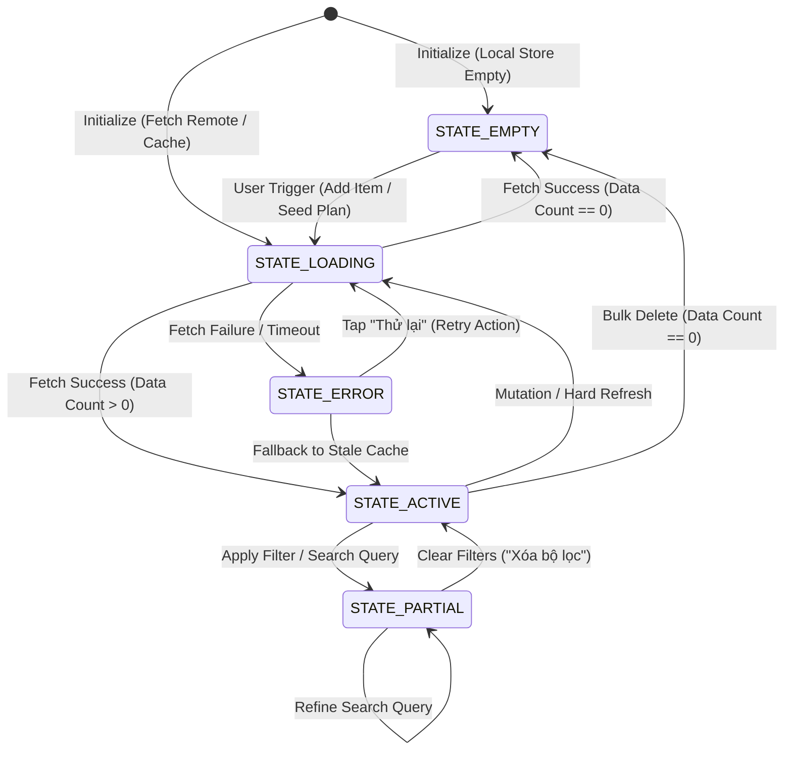
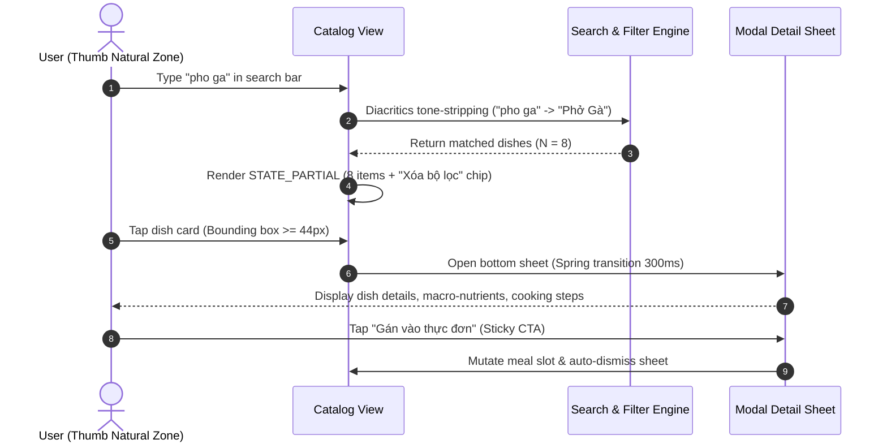

# Mobile Interaction Codex: Flow State Machines & User Journeys

## 1. Executive Overview

In modern native mobile applications (iOS and Android), user interface reliability depends on formalizing every screen and modal as a deterministic **Finite State Machine (FSM)**. Rather than treating views as static templates that occasionally display an activity indicator or a blank screen, every interactive surface in the MealWise design system adheres strictly to the **5 Invariant View States Architecture**.

This codex establishes the formal behavioral specifications, mathematical transitions, error recovery mechanisms, and user journeys across six core application workflows.

```
+---------------------------------------------------------------------------------------+
|                       THE 5 INVARIANT VIEW STATES ARCHITECTURE                        |
+-------------------+-------------------+-------------------+---------------------------+
| 1. Initial/Empty  | 2. Loading/Skel   | 3. Active/Pop     | 4. Error/Retry            |
| Helpful guidance  | Shimmer skeleton  | Virtualized data  | Human explanation         |
| Primary CTA       | CLS = 0 layout    | Full hierarchy    | Prominent "Thử lại"       |
+-------------------+-------------------+-------------------+---------------------------+
|                   | 5. Partial/Filtered State             |                           |
|                   | Active filter tags, match counter     |                           |
|                   | 1-tap "Xóa bộ lọc" reset CTA          |                           |
+-------------------+---------------------------------------+---------------------------+
```

---

## 2. The 5 Invariant View States Specification

Every screen, view container, bottom sheet drawer, and modal component must explicitly implement and render all five lifecycle states. Leaving any state undefined is a violation of the UI/UX architecture.

### 2.1 State 1: Initial / Empty State (`STATE_EMPTY`)
- **Trigger Condition**: Data collection contains zero records ($N = 0$), user has not yet populated items, or local storage has just been initialized.
- **Forbidden Behavior**: Never display a raw blank canvas, an unstyled "No data" string, or a spinner indefinitely.
- **Mandatory Anatomy**:
  1. *Illustration / Graphic Asset*: App-themed visual metaphor (e.g., clean refrigerator outline, empty basket illustration, or culinary icon). Must maintain food/culinary purity—never display human faces or unrelated stock graphics.
  2. *Empathetic, Action-Oriented Headline*: Clear, non-judgmental title (e.g., "Tủ Lạnh Chưa Có Món Nào", "Chưa Có Kế Hoạch Bữa Ăn").
  3. *Contextual Explanatory Subtext*: 1–2 sentences explaining the benefit of populating the screen.
  4. *Primary Action CTA*: Prominent conversion button placed in the thumb's Natural Zone (e.g., "Thêm thực phẩm ngay", "Khám phá món ngon"). Minimum touch target $\ge 44 \times 44\text{px}$.

```tsx
// Canonical Empty State Spec
<div className="flex flex-col items-center justify-center p-8 text-center min-h-[320px]">
  <div className="w-20 h-20 mb-4 rounded-full bg-stone-100 dark:bg-stone-800 flex items-center justify-center text-stone-400">
    <KitchenIcon className="w-10 h-10" />
  </div>
  <h3 className="text-lg font-semibold text-stone-900 dark:text-stone-100 mb-2">
    Tủ Lạnh Chưa Có Món Nào
  </h3>
  <p className="text-sm text-stone-500 dark:text-stone-400 max-w-xs mb-6">
    Nhập nguyên liệu bạn đang có để MealWise tự động gợi ý mâm cơm 3 món chuẩn vị gia đình.
  </p>
  <button className="px-6 py-3 bg-brand-600 hover:bg-brand-700 text-white font-medium rounded-xl min-h-[44px] shadow-sm">
    + Thêm thực phẩm ngay
  </button>
</div>
```

---

### 2.2 State 2: Loading / Skeleton State (`STATE_LOADING`)
- **Trigger Condition**: Asynchronous I/O operation in progress ($t_{\text{wait}} > 100\text{ms}$), initial cache hydration, or search query debounce.
- **Forbidden Behavior**: Never use a standalone spinning wheel centered on an empty white canvas. Generic spinners cause high perceived wait times and fail to communicate spatial layout.
- **Zero Cumulative Layout Shift (CLS = 0) Invariant**:
  The skeleton container MUST replicate the exact bounding dimensions, aspect ratio, border radii, and grid margins of the loaded cards.
- **Animation Mechanics**:
  - CSS shimmer pulse or linear gradient translation ($1500\text{ms}$ cycle).
  - Background surface: `#E7E5E4` (Stone 200) for light mode, `#292524` (Stone 800) for dark mode.
  - Reduced Motion support: Replace continuous translate with a subtle static opacity pulse or disable animation via `@media (prefers-reduced-motion: reduce)`.

---

### 2.3 State 3: Active / Populated State (`STATE_ACTIVE`)
- **Trigger Condition**: Data collection populated ($N \ge 1$), asynchronous payload resolved successfully.
- **Visual Hierarchy & Ergonomics**:
  - High scannability: Hero elements receive Visual Weight $VW \ge 80$, secondary cards $VW \in [55, 80]$.
  - Mobile list container: Responsive grid (1 column on $\le 414\text{px}$, 2 columns on $768\text{px}$).
  - All interactive list row controls, bookmark toggles, and swipe triggers must satisfy the minimum bounding box $\ge 44 \times 44\text{px}$ with $\ge 8\text{px}$ inter-target clearance.
  - Virtualization: Lists exceeding 50 items must employ window virtualization to guarantee $60\text{fps}$ scroll performance.

---

### 2.4 State 4: Error / Retry State (`STATE_ERROR`)
- **Trigger Condition**: Asynchronous request rejection, HTTP 4xx/5xx response, network disconnection (`navigator.onLine === false`), or JSON parsing failure.
- **Forbidden Behavior**: Never display raw developer stack traces, unhandled promise rejection banners, or dead-end alerts with only an "OK" button.
- **Mandatory Anatomy**:
  1. *Error Severity Icon*: High-contrast warning/alert icon in semantic Rose/Amber (`text-rose-600` / `text-amber-600`).
  2. *Human-Readable Diagnostic*: Concise, jargon-free explanation (e.g., "Không thể tải danh sách thực đơn", "Kết nối mạng bị gián đoạn").
  3. *Actionable Recovery Affordance*: Prominent "Thử lại" (Retry) button with hit target $\ge 44 \times 44\text{px}$ wired directly to the idempotency re-fetch callback.
  4. *Secondary Escape Hatch*: Optional fallback action (e.g., "Sử dụng dữ liệu ngoại tuyến" or "Quay lại trang chủ").

```tsx
// Canonical Error State Spec
<div className="flex flex-col items-center justify-center p-6 text-center bg-rose-50/50 dark:bg-rose-950/20 border border-rose-200 dark:border-rose-900 rounded-2xl my-4">
  <AlertCircle className="w-12 h-12 text-rose-600 dark:text-rose-400 mb-3" />
  <h4 className="text-base font-semibold text-stone-900 dark:text-stone-100 mb-1">
    Không thể tải danh sách món ăn
  </h4>
  <p className="text-xs text-stone-600 dark:text-stone-400 mb-4 max-w-xs">
    Kết nối máy chủ bị gián đoạn. Vui lòng kiểm tra lại đường truyền WiFi hoặc 4G/5G.
  </p>
  <button 
    onClick={handleRetry}
    className="px-5 py-2.5 bg-rose-600 hover:bg-rose-700 text-white text-sm font-medium rounded-xl min-h-[44px] min-w-[120px] transition-colors shadow-sm"
  >
    Thử lại
  </button>
</div>
```

---

### 2.5 State 5: Partial / Filtered State (`STATE_PARTIAL`)
- **Trigger Condition**: Active filter pills, dietary toggles, or search keywords applied against a non-empty base database.
- **Scenarios**:
  - *Subset Matched ($N_{\text{filtered}} \ge 1$)*: Display active filter tags with individual "×" dismiss chips, accompanied by an updated counter (e.g., "Hiển thị 14 / 120 món").
  - *Zero Matched ($N_{\text{filtered}} = 0$)*: Render a dedicated filtered-empty card detailing active criteria with a mandatory **1-Tap "Xóa bộ lọc" (Clear filters)** or "Xem tất cả công thức" reset button that instantly restores `STATE_ACTIVE`.
- **Invariance Rule**: The user must never become trapped in a 0-result filtered state without an immediate, 1-tap recovery trigger.

---

## 3. Finite State Machine (FSM) Lifecycle Model

The five invariant view states transition deterministically according to user actions, network events, and filter predicates:



### 3.1 Event-to-State Transition Matrix

| Current State | Event (`ACTION`) | Guard Condition | Next State | Side Effects / UI Affordance |
| :--- | :--- | :--- | :--- | :--- |
| `STATE_EMPTY` | `FETCH_START` | Network call initiated | `STATE_LOADING` | Render skeleton cards matching grid geometry |
| `STATE_LOADING` | `FETCH_SUCCESS` | `payload.length > 0` | `STATE_ACTIVE` | Animate cards in via staggered fade-spring |
| `STATE_LOADING` | `FETCH_SUCCESS` | `payload.length === 0`| `STATE_EMPTY` | Render friendly empty-state illustration & CTA |
| `STATE_LOADING` | `FETCH_ERROR` | Exception thrown | `STATE_ERROR` | Render error banner with "Thử lại" CTA |
| `STATE_ACTIVE` | `FILTER_APPLIED` | `query.length > 0` or tags | `STATE_PARTIAL` | Filter list in-memory; show filter chip bar |
| `STATE_PARTIAL` | `CLEAR_FILTERS` | Tap "Xóa bộ lọc" | `STATE_ACTIVE` | Reset search input, uncheck category pills |
| `STATE_ERROR` | `RETRY_CLICKED` | User taps "Thử lại" | `STATE_LOADING` | Re-dispatch initial fetch query with exp-backoff |

---

## 4. Standardized Mobile User Journeys

### 4.1 Journey 1: Onboarding 4-Step Wizard Flow

The Onboarding Wizard establishes the user's nutritional, cultural, and household context through a 4-step progressive disclosure sequence:

```
[Step 1: Khẩu Vị Vùng Miền] 
       ↓ (Validation: Region selected)
[Step 2: Quy Mô Gia Đình] 
       ↓ (Validation: Count clamped 1-10)
[Step 3: Ngân Sách Đi Chợ] 
       ↓ (Validation: Tier or custom VNĐ)
[Step 4: Chế Độ Ăn & Sức Khỏe] 
       ↓ (Validation: Dietary goals stored)
[Hoàn Tất: Lưu Hồ Sơ & Sinh Thực Đơn]
```

#### Step Breakdown:
1. **Step 1: Regional Flavor & Cuisine Preference (Khẩu vị vùng miền)**
   - Options: Miền Bắc (thanh đạm, chuẩn vị), Miền Trung (đậm đà, cay nồng), Miền Nam (ngọt ngào, phong phú), Miền Tây (chua ngọt, dân dã).
   - Selection rules: Single-select radio card with visual badge and regional seasoning profile description.
2. **Step 2: Household Size / Family Demographics (Quy mô gia đình)**
   - Options: Độc thân (1 người), Cặp đôi (2 người), Gia đình nhỏ (3–4 người), Đại gia đình (5+ người).
   - Servings multiplier calculation:
     $$\text{Multiplier} = \text{HouseholdSize} \times 1.0$$
3. **Step 3: Weekly Budget Tier (Ngân sách đi chợ tuần)**
   - Tiers:
     - *Tiết kiệm*: 35,000 – 50,000 VNĐ / người / ngày
     - *Tiêu chuẩn*: 55,000 – 85,000 VNĐ / người / ngày
     - *Thịnh soạn / Gourmet*: > 90,000 VNĐ / người / ngày
   - Dynamic real-time calculation: Displays estimated weekly total based on Step 2 household size.
4. **Step 4: Dietary Restrictions & Health Goals (Chế độ dinh dưỡng)**
   - Multi-select pill options: Cân bằng tiêu chuẩn, Giảm cân (Low Carb), Tăng cơ (High Protein), Tiểu đường & Tim mạch, Ăn chay (Vegetarian), Không cay (Kid-friendly).

#### Account-Scoped Onboarding & Plan Retention Guard
- **Storage Isolation Invariant**:
  Onboarding completion is strictly scoped per registered account:
  $$\text{StorageKey} = \text{mealwise\_onboarding\_completed\_} + \text{email.toLowerCase()}$$
  Global guest storage flags must NEVER suppress the onboarding survey for newly registered users.
- **Existing Plan Retention Guard**:
  When an unregistered guest who has already configured custom meals in the weekly board registers or completes the onboarding flow:
  - If `hasExistingMeals === true`: The UI must display an explicit confirmation toggle:
    > "Giữ lại thực đơn tuần hiện tại" (Keep current weekly plan)
  - Default: Preserved. The application must NEVER silently overwrite or wipe user-curated meals without explicit confirmation.

---

### 4.2 Journey 2: Exploratory Catalog Browsing Flow

Designed for high-speed discovery across hundreds of traditional Vietnamese dishes and Western meal options.



#### Diacritics Tone-Stripping Search Formula
Vietnamese characters contain complex tone marks. The search engine normalizes strings by removing diacritical marks before computing substring matches:

$$\text{Normalize}(S) = S.\text{normalize}(\text{'NFD'}).\text{replace}(/[\backslash u0300-\backslash u036f]/g, \text{''}).\text{replace}(/đ/g, \text{'d'}).\text{replace}(/Đ/g, \text{'D'}).\text{toLowerCase()}$$

This guarantees that searching `"thit kho"`, `"thịt kho"`, or `"THỊT KHO"` yields identical, accurate results.

---

### 4.3 Journey 3: Multi-Step Wizard Engine (Generic Architecture)

The Multi-Step Wizard Engine governs all complex, multi-stage user workflows (such as Party Catering Planning, FastMeal Apex Generation, and Custom Diet Plan Builders).

#### Formal Machine Definition
A generic wizard instance is defined as a 5-tuple:
$$W = \langle S, E, T, s_0, C \rangle$$
Where:
- $S = \{s_1, s_2, \dots, s_N\}$: Ordered sequence of step views.
- $E = \{\text{NEXT}, \text{PREV}, \text{JUMP}(k), \text{SUBMIT}, \text{RESET}\}$: Allowed navigation events.
- $T: S \times E \times \text{Guard} \to S$: Deterministic transition function.
- $s_0 = s_1$: Initial entry step.
- $C$: Accumulated context payload store.

#### Wizard Navigation Invariants:
1. **Validation Gate**: The `NEXT` event is strictly disabled (`disabled={!isStepValid}`) until all mandatory fields in the active step $s_k$ pass schema validation.
2. **Progress Indicator**: A sticky progress bar at the top displays progress percentage:
   $$P_{\text{progress}} = \frac{k - 1}{N - 1} \times 100\%$$
3. **Dirty-State Exit Protection**: If the user attempts to dismiss the modal after modifying step data, an in-app confirmation modal shields against accidental data loss ("Bạn có thay đổi chưa lưu. Bạn có chắc muốn thoát?").

---

### 4.4 Journey 4: Grocery Cart & Store Channels Flow

The Grocery Cart aggregates ingredient demands from the active 7-day meal plan, normalizes metric units, and provides store channel pricing.

#### Processing Pipeline:
1. **Aggregation & De-duplication**:
   Ingredients across all 21 weekly meal slots are parsed and merged by canonical name:
   $$\text{TotalQuantity}(I) = \sum_{m \in \text{Meals}} \text{ScaleFactor}(m) \times \text{Quantity}(I, m)$$
2. **Real-Life Aisle Grouping**:
   Items are organized into 5 intuitive shopping aisles:
   - Aisle 1: Rau củ quả & Nấm tươi (Fresh Produce)
   - Aisle 2: Thịt, Cá & Thủy hải sản (Fresh Meat & Seafood)
   - Aisle 3: Gia vị, Dầu ăn & Đồ khô (Dry Goods & Seasonings)
   - Aisle 4: Trứng, Sữa & Đậu phụ (Dairy & Tofu)
   - Aisle 5: Bánh mì & Đồ đông lạnh (Bakery & Frozen)
3. **Store Channel Multipliers**:
   Users can toggle between three store channels to compare procurement budgets:
   - *Chợ Dân Sinh (Traditional Market)*: Base multiplier $M_1 = 1.00\times$
   - *Siêu Thị Tiêu Chuẩn (WinMart / Co.op)*: Multiplier $M_2 = 1.08\times$
   - *Cửa Hàng Thực Phẩm Sạch (Organic / Gourmet)*: Multiplier $M_3 = 1.15\times$
4. **Voucher & Free Shipping Threshold Math**:
   - Shipping fee: $30,000\text{ VNĐ}$ if $\text{Subtotal} < 300,000\text{ VNĐ}$; $0\text{ VNĐ}$ if $\text{Subtotal} \ge 300,000\text{ VNĐ}$.
   - Shortfall alert: When subtotal is within $50,000\text{ VNĐ}$ of free shipping, display a motivational banner ("Mua thêm 35.000đ để được Freeship!").

---

### 4.5 Journey 5: Collaborative Grocery Sharing Flow (`Đi Chợ Chung`)

Enables multiple household members to synchronize a real-time shopping cart with live checkoff updates.

#### Synchronization Lifecycle:
1. **Room Creation**: Host initiates a collaborative session; the system generates an uppercase 6-alphanumeric room code (e.g., `MW-8942`).
2. **Time-To-Live (TTL) Policy**: Active rooms expire automatically after **1 hour** ($3600\text{s}$) to prevent orphaned cloud sessions.
3. **Live Sync Protocol**: WebRTC / WebSocket data-channel broadcasts item toggle events (`ITEM_CHECKED`, `ITEM_UNCHECKED`, `QUANTITY_MUTATED`).

#### Guest Account Feature Gating Invariant
- **Rule**: Collaborative Grocery Sharing is strictly reserved for registered users.
- **Unregistered Guest State (`!isRegistered`)**:
  - The collaborative shopping button MUST display a lock badge: `Đi Chợ Chung 🔒`.
  - Tapping this button MUST NOT trigger an unhandled runtime error or crash.
  - Tapping MUST present an in-app `AuthModal` with a clear explanation:
    > "Vui lòng đăng ký hoặc đăng nhập tài khoản MealWise để tạo phòng Đi Chợ Chung và đồng bộ danh sách theo thời gian thực cùng người thân."

---

### 4.6 Journey 6: Draggable Modal Bottom Sheet Flow

Native mobile gesture drawer providing fluid preview and editing affordances without navigating away from the current screen.

```
       [ Drag Handle Pill (36 x 4px) ]
+-----------------------------------------------+
|  Modal Sheet Header (Title + 44px Close Btn)  |
+-----------------------------------------------+
|                                               |
|  Scrollable Body Content (max-h-[75vh])       |
|                                               |
+-----------------------------------------------+
|  Sticky Bottom Action Bar                     |
|  [ pb-[calc(1rem+env(safe-area-inset-bottom))]|
+-----------------------------------------------+
```

#### Gesture Mechanics & Threshold Formulas:
1. **Touch Tracking**:
   - On `onTouchStart`: Record initial touch coordinate $y_0 = \text{event.touches}[0].\text{clientY}$.
   - On `onTouchMove`: Calculate downward drag delta $\Delta y = \max(0, y_{\text{current}} - y_0)$. Apply inline CSS transform: `transform: translateY(${Δy}px)`. Upward dragging is damped by factor $0.2\times$ to provide rubber-banding resistance.
2. **Dismissal Threshold Rule**:
   - If $\Delta y > 75\text{px}$: Trigger dismiss callback. Animate sheet downward off-screen (`translateY(100%)`) over $200\text{ms}$.
   - If $\Delta y \le 75\text{px}$: Snap back to rest position ($\Delta y = 0$) using CSS spring easing `cubic-bezier(0.16, 1, 0.3, 1)`.
3. **Backdrop Tap Shield**:
   Tapping the semi-transparent backdrop (`bg-black/40 backdrop-blur-sm`) dismisses the sheet immediately. Modal content container must execute `e.stopPropagation()` to prevent taps inside the sheet from closing it.

---

## 5. Edge Cases & Boundary Recovery

| Scenario | System State | Trigger / Input | Desired Behavior & Recovery |
| :--- | :--- | :--- | :--- |
| **Complete Network Loss** | Any screen | `window.addEventListener('offline')` | Display non-intrusive top toast ("Mất kết nối Internet - Đang dùng dữ liệu offline"); cache mutations locally in IndexedDB/LocalStorage. |
| **Search Yields 0 Results** | Recipe Catalog | Query `"banh mi pizza bo kho"` matches 0 records | Render `STATE_PARTIAL` with "Không tìm thấy món ăn nào phù hợp" and a 1-tap "Xóa bộ lọc" button. |
| **Guest Attempts Cloud Room** | Grocery List | Guest taps `Đi Chợ Chung 🔒` | Open `AuthModal` in register mode with redirect hook preserving current grocery list state. |
| **Accidental Dismissal** | Onboarding Step 3 | User taps backdrop or native Android back button | Show confirmation dialog: "Hủy khảo sát? Dữ liệu bạn vừa nhập sẽ không được lưu." |
| **Extreme List Length** | Catalog Browsing | User loads 500+ recipes | Enforce dynamic virtualization with 50-item viewport rendering; memory consumption stays $< 35\text{MB}$. |

---

## 6. Implementation Architecture & React Hook Rules

### React Rules of Hooks Compliance
All hooks (`useState`, `useMemo`, `useCallback`, `useEffect`, `useRef`) must be placed unconditionally at the very top of component bodies, strictly BEFORE any conditional checks or early returns:

```tsx
export function FlowStateContainer<T>({ status, data, error, onRetry }: FlowProps<T>) {
  // 1. Unconditional Hooks at the top
  const [localFilter, setLocalFilter] = useState('');
  const scrollRef = useRef<HTMLDivElement>(null);
  
  const filteredData = useMemo(() => {
    if (!data) return [];
    return data.filter(item => matchQuery(item, localFilter));
  }, [data, localFilter]);

  // 2. State-driven conditional returns
  if (status === 'loading') return <SkeletonGrid count={6} />;
  if (status === 'error') return <ErrorRetryBanner error={error} onRetry={onRetry} />;
  if (status === 'empty' || (!data || data.length === 0)) return <EmptyStateView />;
  if (filteredData.length === 0) return <ZeroFilterResult onClear={() => setLocalFilter('')} />;

  // 3. Render Active State
  return <PopulatedListView data={filteredData} />;
}
```

---

## 7. Quality Audit Checklist for Flow States

- [ ] **State Completeness**: Does every view component implement all 5 states (`Empty`, `Loading`, `Active`, `Error`, `Partial`)?
- [ ] **CLS Prevention**: Do loading skeleton cards match the exact dimensions and aspect ratios of populated cards?
- [ ] **Recovery Affordance**: Does every error state feature an immediate, functional "Thử lại" action?
- [ ] **Filter Reset**: Does every 0-result filtered view offer a 1-tap "Xóa bộ lọc" CTA?
- [ ] **Plan Retention**: Does onboarding verify existing weekly plans and offer an explicit retention option before overwriting?
- [ ] **Guest Gating**: Does collaborative grocery sharing show `Đi Chợ Chung 🔒` for guests and prompt login without throwing errors?
